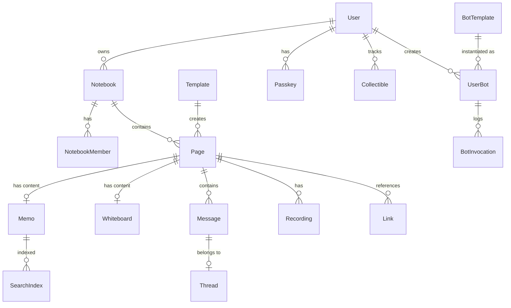

# Data Model

Database schema and relationships for Just Maple.

## Database

Just Maple uses Azure Cosmos DB with MongoDB API. Key limitations to be aware of:

- **No `$text` operator** - Use `$regex` for search
- **No text index weights** - Scoring done in application
- **No `$or` with `.sort()`** - Sort in application after fetch

---

## Entity Relationship Diagram



---

## Collections

### users

User accounts and profiles.

```typescript
interface User {
    _id: ObjectId;
    email: string;
    name: string;
    avatar?: string;
    emailVerified: boolean;
    createdAt: Date;
    updatedAt: Date;
    lastLoginAt?: Date;
    settings?: {
        theme: 'light' | 'dark' | 'system';
        defaultNotebookId?: string;
        aiEnabled: boolean;
    };
}
```

**Indexes:**

- `{ email: 1 }` - unique
- `{ createdAt: -1 }`

**Example:**

```json
{
    "_id": "507f1f77bcf86cd799439011",
    "email": "user@example.com",
    "name": "John Doe",
    "avatar": "https://...",
    "emailVerified": true,
    "createdAt": "2024-01-01T00:00:00Z",
    "updatedAt": "2024-01-15T00:00:00Z",
    "settings": {
        "theme": "dark",
        "aiEnabled": true
    }
}
```

---

### passkeys

WebAuthn passkey credentials.

```typescript
interface Passkey {
    _id: ObjectId;
    userId: ObjectId;
    credentialId: string; // Base64 encoded
    publicKey: string; // Base64 encoded
    counter: number;
    deviceType: 'singleDevice' | 'multiDevice';
    backedUp: boolean;
    transports?: ('usb' | 'ble' | 'nfc' | 'internal')[];
    createdAt: Date;
    lastUsedAt?: Date;
    friendlyName?: string;
}
```

**Indexes:**

- `{ credentialId: 1 }` - unique
- `{ userId: 1 }`

---

### notebooks

Notebook containers for organizing content.

```typescript
interface Notebook {
    _id: ObjectId;
    name: string;
    icon?: string;
    ownerId: ObjectId;
    members: NotebookMember[];
    settings?: {
        defaultPageType: 'memo' | 'whiteboard';
        allowPublicLinks: boolean;
    };
    createdAt: Date;
    updatedAt: Date;
}

interface NotebookMember {
    userId: ObjectId;
    role: 'owner' | 'editor' | 'viewer';
    joinedAt: Date;
    invitedBy?: ObjectId;
}
```

**Indexes:**

- `{ ownerId: 1 }`
- `{ "members.userId": 1 }`
- `{ createdAt: -1 }`

**Example:**

```json
{
    "_id": "507f1f77bcf86cd799439011",
    "name": "Personal Notes",
    "icon": "book",
    "ownerId": "507f1f77bcf86cd799439012",
    "members": [
        {
            "userId": "507f1f77bcf86cd799439012",
            "role": "owner",
            "joinedAt": "2024-01-01T00:00:00Z"
        },
        {
            "userId": "507f1f77bcf86cd799439013",
            "role": "editor",
            "joinedAt": "2024-01-15T00:00:00Z",
            "invitedBy": "507f1f77bcf86cd799439012"
        }
    ],
    "createdAt": "2024-01-01T00:00:00Z",
    "updatedAt": "2024-01-15T00:00:00Z"
}
```

---

### pages

Page metadata (content stored separately in memos/whiteboards).

```typescript
interface Page {
    _id: ObjectId;
    id: string; // UUID v4 or legacy base58
    notebookId: string;
    userId: string; // Owner
    type: 'memo' | 'whiteboard' | 'messages';
    title: string;
    tags: string[]; // Hashtags
    icon?: string;
    pinned: boolean;
    archived: boolean;
    todoMeta?: {
        hasTodos: boolean;
        todoCount: number;
        completedCount: number;
        overdueCount: number;
    };
    createdAt: Date;
    updatedAt: Date;
    deletedAt?: Date;
}
```

**Indexes:**

- `{ id: 1 }` - unique
- `{ notebookId: 1, type: 1 }`
- `{ userId: 1 }`
- `{ tags: 1 }`
- `{ updatedAt: -1 }`

**ID Formats:**

- New pages: UUID v4 (`550e8400-e29b-41d4-a716-446655440000`)
- Legacy pages: Base58 (`3kTMd...`)

**Example:**

```json
{
    "_id": "507f1f77bcf86cd799439011",
    "id": "550e8400-e29b-41d4-a716-446655440000",
    "notebookId": "507f1f77bcf86cd799439012",
    "userId": "507f1f77bcf86cd799439013",
    "type": "memo",
    "title": "Meeting Notes",
    "tags": ["work", "meetings"],
    "pinned": false,
    "archived": false,
    "todoMeta": {
        "hasTodos": true,
        "todoCount": 5,
        "completedCount": 3,
        "overdueCount": 1
    },
    "createdAt": "2024-01-01T00:00:00Z",
    "updatedAt": "2024-01-15T00:00:00Z"
}
```

---

### memos

Y.js document state for memos.

```typescript
interface Memo {
    _id: ObjectId;
    noteId: string; // References pages.id
    state: Binary; // Y.js binary state
    vector?: Binary; // State vector for sync
    version: number;
    updatedAt: Date;
}
```

**Indexes:**

- `{ noteId: 1 }` - unique

**Notes:**

- `state` is binary data (Y.js `Uint8Array`)
- `noteId` references `pages.id` (not `pages._id`)
- Content is CRDT-based for conflict-free merging

---

### whiteboards

Drawing canvas state.

```typescript
interface Whiteboard {
    _id: ObjectId;
    id: string; // References pages.id
    elements: WhiteboardElement[];
    viewport: {
        x: number;
        y: number;
        zoom: number;
    };
    updatedAt: Date;
}

interface WhiteboardElement {
    id: string;
    type: 'rectangle' | 'ellipse' | 'line' | 'arrow' | 'text' | 'image' | 'freehand';
    x: number;
    y: number;
    width?: number;
    height?: number;
    points?: { x: number; y: number }[];
    fill?: string;
    stroke?: string;
    strokeWidth?: number;
    text?: string;
    fontSize?: number;
    imageUrl?: string;
    rotation?: number;
    opacity?: number;
    locked?: boolean;
    groupId?: string;
}
```

**Indexes:**

- `{ id: 1 }` - unique

---

### messages

Chat messages.

```typescript
interface Message {
    _id: ObjectId;
    id: string; // UUID v4
    pageId: string; // Messages page ID
    notebookId: string;
    senderId: string; // User ID
    content: string; // Markdown
    threadId?: string; // Parent thread ID
    replyTo?: string; // Reply to message ID
    reactions?: {
        emoji: string;
        userIds: string[];
    }[];
    attachments?: {
        type: 'image' | 'file';
        url: string;
        name: string;
        size: number;
    }[];
    createdAt: Date;
    updatedAt?: Date;
    deletedAt?: Date;
}
```

**Indexes:**

- `{ id: 1 }` - unique
- `{ pageId: 1, createdAt: -1 }`
- `{ threadId: 1, createdAt: 1 }`
- `{ notebookId: 1 }`

---

### threads

Message thread metadata.

```typescript
interface Thread {
    _id: ObjectId;
    id: string;
    parentMessageId: string;
    notebookId: string;
    messageCount: number;
    lastMessageAt: Date;
}
```

**Indexes:**

- `{ parentMessageId: 1 }` - unique
- `{ notebookId: 1 }`

---

### unread

Unread message tracking per user.

```typescript
interface Unread {
    _id: ObjectId;
    notebookId: string;
    userId: string;
    unreadMessageIds: string[];
    lastUnreadAt: Date;
}
```

**Indexes:**

- `{ notebookId: 1, userId: 1 }` - unique

---

### search_index

Full-text search index.

```typescript
interface SearchIndexEntry {
    _id: ObjectId;
    pageId: string;
    notebookId: string;
    userId: string;
    title: string;
    plainText: string; // Extracted text content
    tags: string[]; // Hashtags
    type: string;
    updatedAt: Date;
}
```

**Indexes:**

- `{ pageId: 1 }` - unique
- `{ userId: 1 }`
- `{ notebookId: 1 }`
- `{ tags: 1 }`

**Notes:**

- `plainText` is extracted from Y.js content
- Search uses `$regex` due to Cosmos DB limitations
- Tags are extracted from `#hashtag` patterns in content

---

### templates

Document templates.

```typescript
interface Template {
    _id: ObjectId;
    name: string;
    description?: string;
    content: string; // Markdown with {{variables}}
    variables: {
        name: string;
        type: 'text' | 'date' | 'select';
        required: boolean;
        default?: string;
        options?: string[]; // For select type
    }[];
    category?: string;
    isSystem: boolean; // System vs user-created
    userId?: ObjectId; // null for system templates
    createdAt: Date;
    updatedAt: Date;
}
```

**Indexes:**

- `{ isSystem: 1, category: 1 }`
- `{ userId: 1 }`

---

### recordings

Voice recordings.

```typescript
interface Recording {
    _id: ObjectId;
    pageId: string;
    userId: string;
    duration: number; // Seconds
    fileUrl: string;
    fileSize: number; // Bytes
    mimeType: string;
    status: 'uploading' | 'uploaded' | 'transcribing' | 'transcribed' | 'failed';
    transcription?: {
        text: string;
        segments: {
            start: number;
            end: number;
            text: string;
        }[];
        language: string;
        confidence: number;
    };
    createdAt: Date;
    transcribedAt?: Date;
}
```

**Indexes:**

- `{ pageId: 1 }`
- `{ userId: 1 }`

---

### links

Page-to-page links (wiki links).

```typescript
interface Link {
    _id: ObjectId;
    sourcePageId: string;
    targetPageId: string;
    context?: string; // Surrounding text
    createdAt: Date;
}
```

**Indexes:**

- `{ sourcePageId: 1 }`
- `{ targetPageId: 1 }`
- `{ sourcePageId: 1, targetPageId: 1 }` - unique

---

### bot_templates

System-defined bot types.

```typescript
interface BotTemplate {
    _id: ObjectId;
    name: string;
    handle: string; // e.g., "claude"
    description: string;
    definition: {
        type: 'llm' | 'http' | 'chain';
        config: LLMConfig | HTTPConfig | ChainConfig;
    };
    requiresConfig: boolean;
    icon?: string;
}

interface LLMConfig {
    model: string;
    systemPrompt?: string;
    temperature?: number;
    maxTokens?: number;
}

interface HTTPConfig {
    url: string;
    method: 'GET' | 'POST';
    headers?: Record<string, string>;
    bodyTemplate?: string;
}
```

**Indexes:**

- `{ handle: 1 }` - unique

---

### user_bots

User-configured bot instances.

```typescript
interface UserBot {
    _id: ObjectId;
    userId: ObjectId;
    templateId: ObjectId;
    name: string;
    handle: string; // Unique per user
    config: Record<string, any>; // API keys, prompts
    notebookIds: string[]; // Shared to these notebooks
    createdAt: Date;
    updatedAt: Date;
}
```

**Indexes:**

- `{ userId: 1, handle: 1 }` - unique
- `{ notebookIds: 1 }`

---

### bot_invocations

Bot execution history.

```typescript
interface BotInvocation {
    _id: ObjectId;
    userBotId: ObjectId;
    userId: ObjectId;
    sourceType: 'chat' | 'document';
    sourceId: string;
    input: {
        text: string;
        context?: string;
    };
    output?: string;
    status: 'pending' | 'running' | 'completed' | 'failed';
    error?: string;
    startedAt: Date;
    completedAt?: Date;
    executionTimeMs?: number;
}
```

**Indexes:**

- `{ userBotId: 1, startedAt: -1 }`
- `{ userId: 1 }`

---

### collectibles

LEGO sets and other collectibles.

```typescript
interface Collectible {
    _id: ObjectId;
    userId: ObjectId;
    type: 'lego' | 'funko' | 'custom';
    // LEGO-specific
    setNumber?: string;
    pieces?: number;
    theme?: string;
    subtheme?: string;
    year?: number;
    // Common fields
    name: string;
    imageUrl?: string;
    status: 'owned' | 'wishlist' | 'building' | 'sold';
    purchaseDate?: Date;
    purchasePrice?: number;
    currentValue?: number;
    location?: string;
    notes?: string;
    rating?: number; // 1-5
    tags: string[];
    createdAt: Date;
    updatedAt: Date;
}
```

**Indexes:**

- `{ userId: 1, type: 1 }`
- `{ setNumber: 1 }` - sparse
- `{ status: 1 }`
- `{ tags: 1 }`

---

### magic_links

Temporary magic link tokens.

```typescript
interface MagicLink {
    _id: ObjectId;
    email: string;
    token: string; // Hashed
    expiresAt: Date;
    usedAt?: Date;
    createdAt: Date;
}
```

**Indexes:**

- `{ token: 1 }` - unique
- `{ email: 1 }`
- `{ expiresAt: 1 }` - TTL index

---

### refresh_tokens

JWT refresh tokens.

```typescript
interface RefreshToken {
    _id: ObjectId;
    userId: ObjectId;
    token: string; // Hashed
    expiresAt: Date;
    createdAt: Date;
    revokedAt?: Date;
    deviceInfo?: {
        userAgent: string;
        ip: string;
    };
}
```

**Indexes:**

- `{ token: 1 }` - unique
- `{ userId: 1 }`
- `{ expiresAt: 1 }` - TTL index

---

## Data Relationships

### Page Content Relationships

```
pages (metadata)
    ├── memos (noteId → pages.id)
    ├── whiteboards (id → pages.id)
    └── messages (pageId → pages.id)
```

**Important:** Content collections reference `pages.id`, not `pages._id`.

### User Ownership

```
users
    ├── notebooks (ownerId)
    ├── pages (userId)
    ├── user_bots (userId)
    ├── collectibles (userId)
    └── passkeys (userId)
```

### Notebook Hierarchy

```
notebooks
    └── pages
        ├── memos
        ├── whiteboards
        └── messages
            └── threads
```

---

## Migration Notes

### ID Format Migration

Legacy pages use base58 IDs. New pages use UUID v4. Both formats are supported:

```typescript
// Validation regex
const UUID_REGEX = /^[0-9a-f]{8}-[0-9a-f]{4}-4[0-9a-f]{3}-[89ab][0-9a-f]{3}-[0-9a-f]{12}$/i;
const BASE58_REGEX = /^[1-9A-HJ-NP-Za-km-z]+$/;

function isValidPageId(id: string): boolean {
    return UUID_REGEX.test(id) || BASE58_REGEX.test(id);
}
```

### Orphaned Data Recovery

When data appears orphaned:

1. Create missing page reference (don't delete data)
2. Update foreign keys if primary keys changed
3. Always confirm with user before deletion

---

## Related Documentation

- [Architecture](./architecture.md) - System overview
- [API Reference](./api-reference.md) - API endpoints
- [Engineering: Sync](./eng-sync.md) - CRDT implementation
