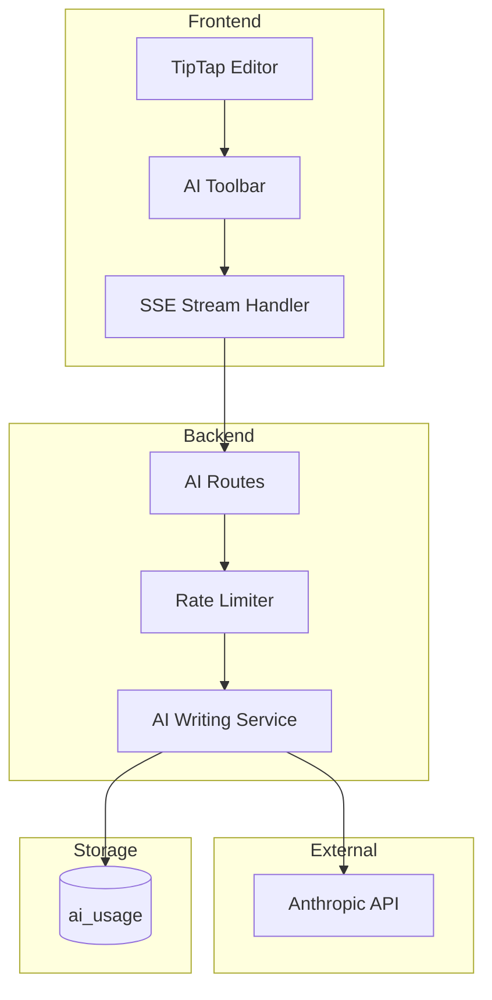

# Engineering: AI Writing Assistant

The AI writing assistant uses Claude (Anthropic API) to help users write better. This document covers the implementation.

## Architecture



## Writing Actions

### Available Actions

```typescript
// apps/api/src/services/ai-writing.service.ts
export type WritingAction =
    | 'continue'
    | 'improve'
    | 'simplify'
    | 'expand'
    | 'shorten'
    | 'summarize'
    | 'grammar'
    | 'translate'
    | 'custom';

const ACTION_PROMPTS: Record<WritingAction, string> = {
    continue: 'Continue writing this text naturally, maintaining the same tone and style.',
    improve: 'Improve this text for better clarity and readability while preserving the meaning.',
    simplify: 'Simplify this text using simpler words and shorter sentences.',
    expand: 'Expand this text with more details, examples, and explanations.',
    shorten: 'Make this text more concise while keeping the key information.',
    summarize: 'Summarize this text in 2-3 sentences.',
    grammar: 'Fix any grammar, spelling, or punctuation errors in this text.',
    translate: 'Translate this text to the specified language.',
    custom: '', // User provides instruction
};
```

## Backend Implementation

### AI Writing Service

```typescript
// apps/api/src/services/ai-writing.service.ts
import Anthropic from '@anthropic-ai/sdk';

@Injectable()
export class AIWritingService {
    private client: Anthropic;

    constructor() {
        this.client = new Anthropic({
            apiKey: process.env.ANTHROPIC_API_KEY,
        });
    }

    async *generateStream(
        action: WritingAction,
        content: string,
        context?: {
            documentContent?: string;
            customInstruction?: string;
            targetLanguage?: string;
        },
    ): AsyncGenerator<string> {
        const systemPrompt = this.buildSystemPrompt(action, context);
        const userPrompt = this.buildUserPrompt(action, content, context);

        const stream = await this.client.messages.stream({
            model: 'claude-sonnet-4-20250514',
            max_tokens: 2000,
            system: systemPrompt,
            messages: [{ role: 'user', content: userPrompt }],
        });

        for await (const chunk of stream) {
            if (chunk.type === 'content_block_delta' && chunk.delta.type === 'text_delta') {
                yield chunk.delta.text;
            }
        }
    }

    private buildSystemPrompt(
        action: WritingAction,
        context?: { documentContent?: string },
    ): string {
        let prompt = `You are a helpful writing assistant. Your task is to help improve text.
Always respond with just the improved text, no explanations or meta-commentary.
Maintain the original language unless explicitly asked to translate.`;

        if (context?.documentContent) {
            prompt += `\n\nContext from the full document:\n${context.documentContent.slice(0, 2000)}`;
        }

        return prompt;
    }

    private buildUserPrompt(
        action: WritingAction,
        content: string,
        context?: { customInstruction?: string; targetLanguage?: string },
    ): string {
        let instruction = ACTION_PROMPTS[action];

        if (action === 'custom' && context?.customInstruction) {
            instruction = context.customInstruction;
        }

        if (action === 'translate' && context?.targetLanguage) {
            instruction = `Translate this text to ${context.targetLanguage}.`;
        }

        return `${instruction}\n\nText to process:\n${content}`;
    }
}
```

### AI Routes

```typescript
// apps/api/src/routes/ai.routes.ts
export const aiRoutes = new Elysia({ prefix: '/api/ai' })
    .use(jwtPlugin)
    .use(authMiddleware)
    .post('/generate/:notebookId', async function* ({ params, body, auth, set }) {
        const { notebookId } = params;
        const { action, content, customInstruction, targetLanguage, documentContent } = body;

        // Rate limiting
        const usage = await getAIUsage(auth.userId);
        if (usage.count >= DAILY_LIMIT) {
            set.status = 429;
            return { error: 'Daily limit exceeded' };
        }

        // Verify notebook access
        const notebook = await getNotebookById(notebookId);
        if (!canAccessNotebook(auth.userId, notebook)) {
            set.status = 403;
            return { error: 'Unauthorized' };
        }

        // Set SSE headers
        set.headers['Content-Type'] = 'text/event-stream';
        set.headers['Cache-Control'] = 'no-cache';
        set.headers['Connection'] = 'keep-alive';

        // Track usage
        await incrementAIUsage(auth.userId);

        // Stream response
        const aiService = new AIWritingService();
        for await (const chunk of aiService.generateStream(action, content, {
            documentContent,
            customInstruction,
            targetLanguage,
        })) {
            yield `data: ${JSON.stringify({ text: chunk })}\n\n`;
        }

        yield 'data: [DONE]\n\n';
    })
    .get('/usage', async ({ auth }) => {
        const usage = await getAIUsage(auth.userId);
        return {
            used: usage.count,
            limit: DAILY_LIMIT,
            remaining: Math.max(0, DAILY_LIMIT - usage.count),
            resetsAt: getNextResetTime(),
        };
    });
```

### Rate Limiting

```typescript
// apps/api/src/repositories/ai-usage.repo.ts
const DAILY_LIMIT = 100; // Requests per day

interface AIUsage {
    userId: string;
    month: string; // YYYY-MM
    count: number;
    tokens: number;
}

export async function getAIUsage(userId: string): Promise<AIUsage> {
    const month = new Date().toISOString().slice(0, 7);

    const usage = await db.collection('ai_usage').findOne({
        userId,
        month,
    });

    return usage || { userId, month, count: 0, tokens: 0 };
}

export async function incrementAIUsage(userId: string, tokens = 0): Promise<void> {
    const month = new Date().toISOString().slice(0, 7);

    await db.collection('ai_usage').updateOne(
        { userId, month },
        {
            $inc: { count: 1, tokens },
            $setOnInsert: { createdAt: new Date() },
        },
        { upsert: true },
    );
}
```

## Frontend Implementation

### AI Writing Service

```typescript
// apps/web/src/app/services/ai-writing.service.ts
@Injectable({ providedIn: 'root' })
export class AIWritingService {
    private http = inject(HttpClient);

    async *streamGeneration(
        notebookId: string,
        action: WritingAction,
        content: string,
        options?: {
            customInstruction?: string;
            targetLanguage?: string;
            documentContent?: string;
        },
    ): AsyncGenerator<string> {
        const response = await fetch(`/api/ai/generate/${notebookId}`, {
            method: 'POST',
            headers: { 'Content-Type': 'application/json' },
            body: JSON.stringify({
                action,
                content,
                ...options,
            }),
        });

        if (!response.ok) {
            throw new Error('AI generation failed');
        }

        const reader = response.body!.getReader();
        const decoder = new TextDecoder();

        while (true) {
            const { done, value } = await reader.read();
            if (done) break;

            const chunk = decoder.decode(value);
            const lines = chunk.split('\n');

            for (const line of lines) {
                if (line.startsWith('data: ')) {
                    const data = line.slice(6);
                    if (data === '[DONE]') return;

                    try {
                        const parsed = JSON.parse(data);
                        yield parsed.text;
                    } catch {
                        // Skip invalid JSON
                    }
                }
            }
        }
    }

    async getUsage(): Promise<AIUsageInfo> {
        return firstValueFrom(this.http.get<AIUsageInfo>('/api/ai/usage'));
    }
}
```

### AI Toolbar Component

```typescript
// apps/web/src/app/components/molecules/ai-toolbar/ai-toolbar.component.ts
@Component({
    selector: 'app-ai-toolbar',
    templateUrl: './ai-toolbar.component.html',
})
export class AIToolbarComponent {
    private aiService = inject(AIWritingService);
    private editor = inject(EditorService);

    @Input() notebookId!: string;

    readonly isGenerating = signal(false);
    readonly generatedText = signal('');
    readonly showCustomInput = signal(false);

    readonly actions: WritingAction[] = [
        'continue',
        'improve',
        'simplify',
        'expand',
        'shorten',
        'summarize',
        'grammar',
        'translate',
    ];

    async executeAction(action: WritingAction): Promise<void> {
        const selection = this.editor.getSelectedText();
        if (!selection && action !== 'continue') {
            return;
        }

        this.isGenerating.set(true);
        this.generatedText.set('');

        try {
            for await (const chunk of this.aiService.streamGeneration(
                this.notebookId,
                action,
                selection || '',
                {
                    documentContent: this.editor.getDocumentContent(),
                },
            )) {
                this.generatedText.update((text) => text + chunk);
            }
        } finally {
            this.isGenerating.set(false);
        }
    }

    acceptResult(): void {
        this.editor.replaceSelection(this.generatedText());
        this.generatedText.set('');
    }

    regenerate(): void {
        // Re-run with same action
    }

    cancel(): void {
        this.isGenerating.set(false);
        this.generatedText.set('');
    }
}
```

### AI Toolbar Template

```html
<!-- ai-toolbar.component.html -->
<div class="ai-toolbar" *ngIf="hasSelection()">
    <div class="actions">
        @for (action of actions; track action) {
        <button (click)="executeAction(action)" [disabled]="isGenerating()" class="action-btn">
            {{ action }}
        </button>
        }
        <button (click)="showCustomInput.set(true)">Custom</button>
    </div>

    @if (showCustomInput()) {
    <div class="custom-input">
        <input
            #customInput
            placeholder="Enter your instruction..."
            (keydown.enter)="executeCustomAction(customInput.value)"
        />
    </div>
    } @if (isGenerating() || generatedText()) {
    <div class="result-panel">
        <div class="generated-text">
            {{ generatedText() }} @if (isGenerating()) {
            <span class="cursor">|</span>
            }
        </div>

        <div class="result-actions">
            @if (isGenerating()) {
            <button (click)="cancel()">Stop</button>
            } @else {
            <button (click)="acceptResult()">Accept</button>
            <button (click)="regenerate()">Regenerate</button>
            <button (click)="cancel()">Discard</button>
            }
        </div>
    </div>
    }
</div>
```

## Context Handling

### Document Context

```typescript
// Include surrounding context for better results
function getContextForAI(editor: Editor, maxLength = 2000): string {
    const fullContent = editor.getJSON();
    const text = extractPlainText(fullContent);

    if (text.length <= maxLength) {
        return text;
    }

    // Get selection position
    const { from, to } = editor.state.selection;

    // Include context around selection
    const start = Math.max(0, from - maxLength / 2);
    const end = Math.min(text.length, to + maxLength / 2);

    return text.slice(start, end);
}
```

## Error Handling

```typescript
// Handle API errors gracefully
async function handleAIError(error: any): Promise<void> {
    if (error.status === 429) {
        showToast('Daily AI limit reached. Try again tomorrow.');
    } else if (error.status === 503) {
        showToast('AI service temporarily unavailable.');
    } else {
        showToast('AI generation failed. Please try again.');
    }
}
```

## Related Documentation

- [Feature: AI Writing](./feature-ai-writing.md) - User documentation
- [Engineering: Bots](./eng-bots.md) - Bot AI integration
- [API Reference](./api-reference.md) - AI endpoints
