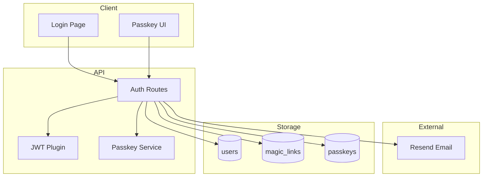

# Engineering: Authentication

Just Maple uses passwordless authentication with magic links and WebAuthn passkeys. This document covers the implementation details.

## Overview

### Authentication Methods

1. **Magic Links** - Email-based one-time login
2. **Passkeys** - WebAuthn-based biometric/hardware keys

### Token Strategy

- JWT tokens for API authentication
- httpOnly cookies for web
- Keychain/Keystore for native apps
- Token refresh via silent re-auth

## Architecture



## Magic Link Flow

### Request Magic Link

**Endpoint:** `POST /api/auth/magic-link`

```typescript
// apps/api/src/routes/auth.routes.ts
.post('/magic-link', async ({ body }) => {
    const { email } = body;

    // Find or create user
    let user = await findUserByEmail(email);
    if (!user) {
        user = await createUser({ email });
    }

    // Generate token
    const token = crypto.randomUUID();
    const expiresAt = new Date(Date.now() + 15 * 60 * 1000); // 15 min

    // Store magic link
    await createMagicLink({
        userId: user._id,
        token,
        expiresAt,
    });

    // Send email via Resend
    await sendMagicLinkEmail(email, token);

    return { success: true };
})
```

### Verify Magic Link

**Endpoint:** `GET /api/auth/verify?token=...`

```typescript
.get('/verify', async ({ query, jwt, cookie }) => {
    const { token } = query;

    // Find and validate magic link
    const magicLink = await findMagicLinkByToken(token);
    if (!magicLink || magicLink.expiresAt < new Date()) {
        throw new Error('Invalid or expired link');
    }

    // Get user
    const user = await findUserById(magicLink.userId);

    // Delete used magic link
    await deleteMagicLink(magicLink._id);

    // Generate JWT
    const jwtToken = await jwt.sign({
        sub: user._id.toString(),
        email: user.email,
    });

    // Set cookie
    cookie.auth.set({
        value: jwtToken,
        httpOnly: true,
        secure: true,
        sameSite: 'strict',
        maxAge: 7 * 24 * 60 * 60, // 7 days
    });

    return { user };
})
```

## Passkey Flow

### Registration Start

**Endpoint:** `POST /api/auth/passkey/register/start`

```typescript
import { generateRegistrationOptions } from '@simplewebauthn/server';

.post('/passkey/register/start', async ({ auth }) => {
    const user = auth.user;

    const options = await generateRegistrationOptions({
        rpName: 'Just Maple',
        rpID: 'justmaple.app',
        userID: user._id.toString(),
        userName: user.email,
        attestationType: 'none',
        authenticatorSelection: {
            residentKey: 'required',
            userVerification: 'preferred',
        },
    });

    // Store challenge for verification
    await storeChallenge(user._id, options.challenge);

    return options;
})
```

### Registration Finish

**Endpoint:** `POST /api/auth/passkey/register/finish`

```typescript
import { verifyRegistrationResponse } from '@simplewebauthn/server';

.post('/passkey/register/finish', async ({ auth, body }) => {
    const user = auth.user;
    const challenge = await getChallenge(user._id);

    const verification = await verifyRegistrationResponse({
        response: body,
        expectedChallenge: challenge,
        expectedOrigin: 'https://justmaple.app',
        expectedRPID: 'justmaple.app',
    });

    if (verification.verified) {
        // Store passkey
        await createPasskey({
            userId: user._id,
            credentialId: verification.registrationInfo.credentialID,
            publicKey: verification.registrationInfo.credentialPublicKey,
            counter: verification.registrationInfo.counter,
        });
    }

    return { verified: verification.verified };
})
```

### Login Start

**Endpoint:** `POST /api/auth/passkey/login/start`

```typescript
import { generateAuthenticationOptions } from '@simplewebauthn/server';

.post('/passkey/login/start', async ({ body }) => {
    const { email } = body;
    const user = await findUserByEmail(email);
    const passkeys = await getPasskeysByUserId(user._id);

    const options = await generateAuthenticationOptions({
        rpID: 'justmaple.app',
        allowCredentials: passkeys.map(pk => ({
            id: pk.credentialId,
            type: 'public-key',
        })),
        userVerification: 'preferred',
    });

    await storeChallenge(user._id, options.challenge);

    return options;
})
```

### Login Finish

**Endpoint:** `POST /api/auth/passkey/login/finish`

```typescript
import { verifyAuthenticationResponse } from '@simplewebauthn/server';

.post('/passkey/login/finish', async ({ body, jwt, cookie }) => {
    const passkey = await findPasskeyByCredentialId(body.id);
    const user = await findUserById(passkey.userId);
    const challenge = await getChallenge(user._id);

    const verification = await verifyAuthenticationResponse({
        response: body,
        expectedChallenge: challenge,
        expectedOrigin: 'https://justmaple.app',
        expectedRPID: 'justmaple.app',
        authenticator: {
            credentialID: passkey.credentialId,
            credentialPublicKey: passkey.publicKey,
            counter: passkey.counter,
        },
    });

    if (verification.verified) {
        // Update counter
        await updatePasskeyCounter(passkey._id, verification.authenticationInfo.newCounter);

        // Issue JWT
        const jwtToken = await jwt.sign({
            sub: user._id.toString(),
            email: user.email,
        });

        cookie.auth.set({ value: jwtToken, /* ... */ });
    }

    return { verified: verification.verified, user };
})
```

## JWT Implementation

### JWT Plugin

```typescript
// apps/api/src/middleware/jwt.plugin.ts
import { jwt } from '@elysiajs/jwt';

export const jwtPlugin = jwt({
    name: 'jwt',
    secret: process.env.JWT_SECRET!,
    exp: '7d',
});
```

### Auth Middleware

```typescript
// apps/api/src/middleware/auth.middleware.ts
export const authMiddleware = (app: Elysia) =>
    app.derive(async ({ jwt, cookie, set }) => {
        const token = cookie.auth.value;

        if (!token) {
            return { auth: null };
        }

        try {
            const payload = await jwt.verify(token);
            const user = await findUserById(payload.sub);

            return {
                auth: {
                    user,
                    userId: user._id,
                },
            };
        } catch {
            return { auth: null };
        }
    });
```

### Protected Routes

```typescript
// Usage in routes
export const notebookRoutes = new Elysia({ prefix: '/api/notebooks' })
    .use(jwtPlugin)
    .use(authMiddleware)
    .get('/', async ({ auth, set }) => {
        if (!auth) {
            set.status = 401;
            return { error: 'Unauthorized' };
        }

        return await getNotebooksByUserId(auth.userId);
    });
```

## Frontend Implementation

### Auth Service (Angular)

```typescript
// apps/web/src/app/services/auth.service.ts
@Injectable({ providedIn: 'root' })
export class AuthService {
    private http = inject(HttpClient);
    private user = signal<User | null>(null);

    readonly currentUser = this.user.asReadonly();
    readonly isAuthenticated = computed(() => !!this.user());

    async requestMagicLink(email: string): Promise<void> {
        await firstValueFrom(this.http.post('/api/auth/magic-link', { email }));
    }

    async verifyMagicLink(token: string): Promise<User> {
        const response = await firstValueFrom(
            this.http.get<{ user: User }>(`/api/auth/verify?token=${token}`),
        );
        this.user.set(response.user);
        return response.user;
    }

    async registerPasskey(): Promise<void> {
        // Get options from server
        const options = await firstValueFrom(
            this.http.post<PublicKeyCredentialCreationOptions>(
                '/api/auth/passkey/register/start',
                {},
            ),
        );

        // Create credential using WebAuthn API
        const credential = await navigator.credentials.create({
            publicKey: options,
        });

        // Send to server
        await firstValueFrom(this.http.post('/api/auth/passkey/register/finish', credential));
    }

    async loginWithPasskey(email: string): Promise<User> {
        // Get options
        const options = await firstValueFrom(
            this.http.post<PublicKeyCredentialRequestOptions>('/api/auth/passkey/login/start', {
                email,
            }),
        );

        // Get credential
        const credential = await navigator.credentials.get({
            publicKey: options,
        });

        // Verify
        const response = await firstValueFrom(
            this.http.post<{ user: User }>('/api/auth/passkey/login/finish', credential),
        );

        this.user.set(response.user);
        return response.user;
    }

    async logout(): Promise<void> {
        await firstValueFrom(this.http.post('/api/auth/logout', {}));
        this.user.set(null);
    }
}
```

## Native Implementation (Swift)

### Keychain Storage

```swift
// apps/apple/Shared/Services/KeychainService.swift
class KeychainService {
    static let shared = KeychainService()

    func saveToken(_ token: String, for server: String) throws {
        let data = token.data(using: .utf8)!

        let query: [String: Any] = [
            kSecClass as String: kSecClassGenericPassword,
            kSecAttrService as String: "justmaple",
            kSecAttrAccount as String: server,
            kSecValueData as String: data,
        ]

        SecItemDelete(query as CFDictionary)
        let status = SecItemAdd(query as CFDictionary, nil)

        guard status == errSecSuccess else {
            throw KeychainError.saveFailed
        }
    }

    func getToken(for server: String) throws -> String? {
        let query: [String: Any] = [
            kSecClass as String: kSecClassGenericPassword,
            kSecAttrService as String: "justmaple",
            kSecAttrAccount as String: server,
            kSecReturnData as String: true,
        ]

        var result: AnyObject?
        let status = SecItemCopyMatching(query as CFDictionary, &result)

        guard status == errSecSuccess,
              let data = result as? Data,
              let token = String(data: data, encoding: .utf8) else {
            return nil
        }

        return token
    }
}
```

## Security Considerations

### Token Security

- JWTs signed with strong secret
- Short expiration (7 days)
- httpOnly cookies prevent XSS access
- Secure flag ensures HTTPS only

### Magic Link Security

- 15-minute expiration
- Single use (deleted after verification)
- Random UUID tokens (unguessable)
- Rate limiting on requests

### Passkey Security

- Private keys never leave device
- Biometric/PIN verification
- Replay attack prevention via counters
- Origin validation

## Database Schema

```typescript
// magic_links collection
interface MagicLink {
    _id: ObjectId;
    userId: ObjectId;
    token: string; // UUID
    expiresAt: Date; // TTL index
    createdAt: Date;
}

// passkeys collection
interface Passkey {
    _id: ObjectId;
    userId: ObjectId;
    credentialId: Buffer;
    publicKey: Buffer;
    counter: number;
    createdAt: Date;
}
```

## Related Documentation

- [Architecture](./architecture.md) - System overview
- [API Reference](./api-reference.md) - Auth endpoints
- [Data Model](./data-model.md) - User schema
