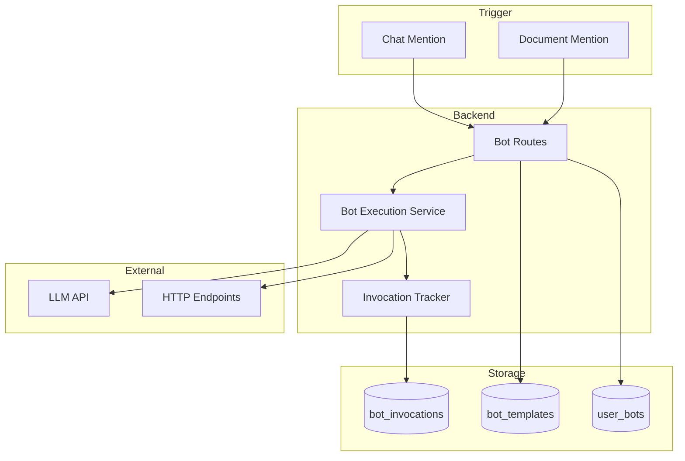

# Engineering: Bot System

The bot system allows users to create AI-powered assistants that respond to mentions in chat and documents. This document covers the implementation.

## Architecture



## Data Model

### Bot Templates

```typescript
// bot_templates collection - System-defined bot types
interface BotTemplate {
    _id: ObjectId;
    name: string; // "Claude AI"
    handle: string; // "claude"
    description: string;
    definition: BotDefinition;
    requiresConfig: boolean; // Needs API key, etc.
    icon?: string;
}

interface BotDefinition {
    type: 'llm' | 'http' | 'chain';
    config: LLMConfig | HTTPConfig | ChainConfig;
}

interface LLMConfig {
    model: string;
    systemPrompt?: string;
    temperature?: number;
    maxTokens?: number;
}

interface HTTPConfig {
    url: string;
    method: 'GET' | 'POST';
    headers?: Record<string, string>;
    bodyTemplate?: string;
}
```

### User Bots

```typescript
// user_bots collection - User-registered bots
interface UserBot {
    _id: ObjectId;
    userId: ObjectId;
    templateId: ObjectId;
    name: string; // "My Claude"
    handle: string; // "my-claude"
    config: Record<string, any>; // API keys, custom prompts
    notebookIds: string[]; // Shared to these notebooks
    createdAt: Date;
    updatedAt: Date;
}
```

### Bot Invocations

```typescript
// bot_invocations collection - Execution history
interface BotInvocation {
    _id: ObjectId;
    userBotId: ObjectId;
    userId: ObjectId; // Who triggered
    sourceType: 'chat' | 'document';
    sourceId: string; // Message or page ID
    input: {
        text: string;
        context?: string;
    };
    output?: string;
    status: 'pending' | 'running' | 'completed' | 'failed';
    error?: string;
    startedAt: Date;
    completedAt?: Date;
    executionTimeMs?: number;
}
```

## Bot Execution Service

```typescript
// apps/api/src/services/bot-execution.service.ts
export class BotExecutionService {
    async invoke(userBot: UserBot, input: BotInput): Promise<BotOutput> {
        const template = await getBotTemplate(userBot.templateId);

        // Create invocation record
        const invocation = await createInvocation({
            userBotId: userBot._id,
            userId: input.userId,
            sourceType: input.sourceType,
            sourceId: input.sourceId,
            input: {
                text: input.text,
                context: input.context,
            },
            status: 'running',
            startedAt: new Date(),
        });

        try {
            const result = await this.execute(template, userBot, input);

            // Update invocation with result
            await updateInvocation(invocation._id, {
                status: 'completed',
                output: result.text,
                completedAt: new Date(),
                executionTimeMs: Date.now() - invocation.startedAt.getTime(),
            });

            return result;
        } catch (error) {
            await updateInvocation(invocation._id, {
                status: 'failed',
                error: error.message,
                completedAt: new Date(),
            });
            throw error;
        }
    }

    private async execute(
        template: BotTemplate,
        userBot: UserBot,
        input: BotInput,
    ): Promise<BotOutput> {
        switch (template.definition.type) {
            case 'llm':
                return this.executeLLM(template.definition.config, userBot, input);
            case 'http':
                return this.executeHTTP(template.definition.config, userBot, input);
            case 'chain':
                return this.executeChain(template.definition.config, userBot, input);
            default:
                throw new Error(`Unknown bot type: ${template.definition.type}`);
        }
    }

    private async executeLLM(
        config: LLMConfig,
        userBot: UserBot,
        input: BotInput,
    ): Promise<BotOutput> {
        const client = new Anthropic({
            apiKey: userBot.config.apiKey || process.env.ANTHROPIC_API_KEY,
        });

        const systemPrompt = userBot.config.systemPrompt || config.systemPrompt || '';

        const response = await client.messages.create({
            model: config.model || 'claude-sonnet-4-20250514',
            max_tokens: config.maxTokens || 1000,
            system: systemPrompt,
            messages: [
                {
                    role: 'user',
                    content: this.buildPrompt(input),
                },
            ],
        });

        return {
            text: response.content[0].type === 'text' ? response.content[0].text : '',
            metadata: {
                model: config.model,
                tokens: response.usage,
            },
        };
    }

    private async executeHTTP(
        config: HTTPConfig,
        userBot: UserBot,
        input: BotInput,
    ): Promise<BotOutput> {
        const body = config.bodyTemplate
            ? this.interpolate(config.bodyTemplate, input)
            : JSON.stringify({ text: input.text });

        const response = await fetch(config.url, {
            method: config.method,
            headers: {
                'Content-Type': 'application/json',
                ...config.headers,
                ...userBot.config.headers,
            },
            body: config.method === 'POST' ? body : undefined,
        });

        const data = await response.json();

        return {
            text: typeof data === 'string' ? data : JSON.stringify(data),
            metadata: { statusCode: response.status },
        };
    }

    private buildPrompt(input: BotInput): string {
        let prompt = input.text;

        if (input.context) {
            prompt = `Context:\n${input.context}\n\nUser message:\n${input.text}`;
        }

        return prompt;
    }

    private interpolate(template: string, input: BotInput): string {
        return template.replace('{{text}}', input.text).replace('{{context}}', input.context || '');
    }
}
```

## Bot Routes

```typescript
// apps/api/src/routes/bot.routes.ts
export const botRoutes = new Elysia({ prefix: '/api/bots' })
    .use(jwtPlugin)
    .use(authMiddleware)
    // Templates
    .get('/templates', async () => {
        return await getAllBotTemplates();
    })
    .get('/templates/:id', async ({ params }) => {
        return await getBotTemplate(params.id);
    })
    // User bots
    .get('/users', async ({ auth }) => {
        return await getUserBots(auth.userId);
    })
    .post('/users', async ({ body, auth }) => {
        const { templateId, name, handle, config } = body;

        // Validate handle uniqueness
        if (await isHandleTaken(handle, auth.userId)) {
            throw new Error('Handle already in use');
        }

        return await createUserBot({
            userId: auth.userId,
            templateId,
            name,
            handle,
            config,
            notebookIds: [],
        });
    })
    .put('/users/:id', async ({ params, body, auth }) => {
        const userBot = await getUserBot(params.id);

        if (userBot.userId.toString() !== auth.userId) {
            throw new Error('Unauthorized');
        }

        return await updateUserBot(params.id, body);
    })
    .delete('/users/:id', async ({ params, auth }) => {
        const userBot = await getUserBot(params.id);

        if (userBot.userId.toString() !== auth.userId) {
            throw new Error('Unauthorized');
        }

        await deleteUserBot(params.id);
        return { success: true };
    })
    // Invocation
    .post('/invoke', async ({ body, auth }) => {
        const { userBotId, text, context, sourceType, sourceId } = body;

        const userBot = await getUserBot(userBotId);

        // Verify access
        if (!canInvokeBot(auth.userId, userBot)) {
            throw new Error('Unauthorized');
        }

        const botService = new BotExecutionService();
        const result = await botService.invoke(userBot, {
            userId: auth.userId,
            text,
            context,
            sourceType,
            sourceId,
        });

        return result;
    })
    // Invocation history
    .get('/invocations', async ({ query, auth }) => {
        const { userBotId, limit } = query;

        return await getInvocations({
            userId: auth.userId,
            userBotId,
            limit: limit ? parseInt(limit) : 50,
        });
    });
```

## Chat Integration

### Mention Detection

```typescript
// apps/web/src/app/services/bot-mention.service.ts
@Injectable()
export class BotMentionService {
    private botService = inject(BotService);

    readonly availableBots = signal<UserBot[]>([]);

    detectMentions(text: string): BotMention[] {
        const mentionRegex = /@([\w-]+)/g;
        const mentions: BotMention[] = [];
        let match;

        while ((match = mentionRegex.exec(text)) !== null) {
            const handle = match[1];
            const bot = this.findBotByHandle(handle);

            if (bot) {
                mentions.push({
                    bot,
                    index: match.index,
                    length: match[0].length,
                });
            }
        }

        return mentions;
    }

    private findBotByHandle(handle: string): UserBot | null {
        return (
            this.availableBots().find((b) => b.handle.toLowerCase() === handle.toLowerCase()) ||
            null
        );
    }
}
```

### Invoking Bots from Chat

```typescript
// apps/web/src/app/services/chat.service.ts
async sendMessageWithBots(content: string): Promise<void> {
    // Send the message first
    const message = await this.sendMessage(content);

    // Detect and invoke bots
    const mentions = this.botMentionService.detectMentions(content);

    for (const mention of mentions) {
        // Get context (recent messages, document content)
        const context = await this.buildBotContext(mention.bot);

        // Invoke bot
        const response = await this.botService.invoke({
            userBotId: mention.bot._id,
            text: content,
            context,
            sourceType: 'chat',
            sourceId: message.id,
        });

        // Post bot response as reply
        await this.sendMessage(response.text, message.id);
    }
}

private async buildBotContext(bot: UserBot): Promise<string> {
    const recentMessages = this.messages().slice(0, 10);
    return recentMessages
        .map(m => `${m.sender.name}: ${m.content}`)
        .join('\n');
}
```

## Notebook Bot Sharing

```typescript
// Share bot with notebook
export async function shareBotToNotebook(
    userBotId: string,
    notebookId: string,
    userId: string,
): Promise<void> {
    const userBot = await getUserBot(userBotId);

    // Must own the bot
    if (userBot.userId.toString() !== userId) {
        throw new Error('Unauthorized');
    }

    // Must have access to notebook
    const notebook = await getNotebookById(notebookId);
    if (!canManageNotebook(userId, notebook)) {
        throw new Error('Unauthorized');
    }

    await db
        .collection('user_bots')
        .updateOne({ _id: new ObjectId(userBotId) }, { $addToSet: { notebookIds: notebookId } });
}

// Get bots available in notebook
export async function getBotsForNotebook(notebookId: string): Promise<UserBot[]> {
    return db.collection('user_bots').find({ notebookIds: notebookId }).toArray();
}
```

## Frontend Bot Management

```typescript
// apps/web/src/app/pages/bot-settings/bot-settings.component.ts
@Component({
    selector: 'app-bot-settings',
    templateUrl: './bot-settings.component.html',
})
export class BotSettingsComponent {
    private botService = inject(BotService);

    readonly templates = signal<BotTemplate[]>([]);
    readonly userBots = signal<UserBot[]>([]);
    readonly selectedBot = signal<UserBot | null>(null);

    async ngOnInit(): Promise<void> {
        const [templates, bots] = await Promise.all([
            this.botService.getTemplates(),
            this.botService.getUserBots(),
        ]);

        this.templates.set(templates);
        this.userBots.set(bots);
    }

    async createBot(data: CreateBotData): Promise<void> {
        const bot = await this.botService.createBot(data);
        this.userBots.update((bots) => [...bots, bot]);
    }

    async updateBot(id: string, data: Partial<UserBot>): Promise<void> {
        await this.botService.updateBot(id, data);
        this.userBots.update((bots) => bots.map((b) => (b._id === id ? { ...b, ...data } : b)));
    }

    async deleteBot(id: string): Promise<void> {
        await this.botService.deleteBot(id);
        this.userBots.update((bots) => bots.filter((b) => b._id !== id));
    }
}
```

## Related Documentation

- [Feature: Bots](./feature-bots.md) - User documentation
- [Engineering: AI Writing](./eng-ai-writing.md) - AI implementation
- [Engineering: Chat](./eng-chat.md) - Chat integration
