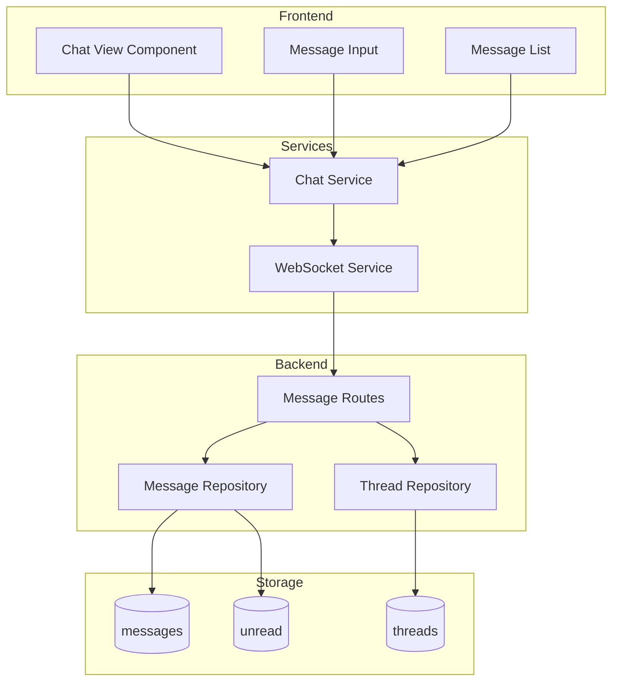

# Engineering: Chat & Messaging

Chat provides real-time communication within notebooks. This document covers the messaging implementation.

## Architecture



## Data Model

### Message Schema

```typescript
// packages/shared/src/schemas/message.ts
import { Type, Static } from '@sinclair/typebox';

export const MessageSchema = Type.Object({
    _id: Type.String(),
    id: Type.String(), // UUID
    pageId: Type.String(), // Messages page ID
    notebookId: Type.String(),
    senderId: Type.String(), // User ID
    content: Type.String(), // Message text (markdown)
    threadId: Type.Optional(Type.String()), // Parent thread ID
    replyTo: Type.Optional(Type.String()), // Reply to message ID
    createdAt: Type.String(),
    updatedAt: Type.Optional(Type.String()),
    deletedAt: Type.Optional(Type.String()),
});

export type Message = Static<typeof MessageSchema>;

// Thread schema
export const ThreadSchema = Type.Object({
    _id: Type.String(),
    id: Type.String(),
    parentMessageId: Type.String(),
    notebookId: Type.String(),
    messageCount: Type.Number(),
    lastMessageAt: Type.String(),
});

export type Thread = Static<typeof ThreadSchema>;
```

## Backend Implementation

### Message Repository

```typescript
// apps/api/src/repositories/message.repo.ts
import { ObjectId } from 'mongodb';

export async function createMessage(data: {
    pageId: string;
    notebookId: string;
    senderId: string;
    content: string;
    replyTo?: string;
}): Promise<Message> {
    const message: Message = {
        _id: new ObjectId().toString(),
        id: crypto.randomUUID(),
        pageId: data.pageId,
        notebookId: data.notebookId,
        senderId: data.senderId,
        content: data.content,
        replyTo: data.replyTo,
        createdAt: new Date().toISOString(),
    };

    // If replying, get or create thread
    if (data.replyTo) {
        const parentMessage = await getMessageById(data.replyTo);
        if (parentMessage) {
            const thread = await getOrCreateThread(parentMessage);
            message.threadId = thread.id;

            // Update thread stats
            await updateThreadStats(thread.id);
        }
    }

    await db.collection('messages').insertOne(message);

    // Update unread for all other notebook members
    await markUnreadForMembers(data.notebookId, data.senderId, message.id);

    return message;
}

export async function getMessages(
    pageId: string,
    options: { limit?: number; before?: string } = {},
): Promise<Message[]> {
    const query: any = {
        pageId,
        deletedAt: { $exists: false },
        threadId: { $exists: false }, // Only root messages
    };

    if (options.before) {
        const beforeMessage = await getMessageById(options.before);
        if (beforeMessage) {
            query.createdAt = { $lt: beforeMessage.createdAt };
        }
    }

    return db
        .collection('messages')
        .find(query)
        .sort({ createdAt: -1 })
        .limit(options.limit || 50)
        .toArray();
}

export async function getThreadMessages(threadId: string): Promise<Message[]> {
    return db
        .collection('messages')
        .find({ threadId, deletedAt: { $exists: false } })
        .sort({ createdAt: 1 })
        .toArray();
}

async function getOrCreateThread(parentMessage: Message): Promise<Thread> {
    let thread = await db.collection('threads').findOne({
        parentMessageId: parentMessage.id,
    });

    if (!thread) {
        thread = {
            _id: new ObjectId(),
            id: crypto.randomUUID(),
            parentMessageId: parentMessage.id,
            notebookId: parentMessage.notebookId,
            messageCount: 0,
            lastMessageAt: new Date().toISOString(),
        };
        await db.collection('threads').insertOne(thread);
    }

    return thread;
}

async function updateThreadStats(threadId: string): Promise<void> {
    const count = await db.collection('messages').countDocuments({ threadId });

    await db.collection('threads').updateOne(
        { id: threadId },
        {
            $set: {
                messageCount: count,
                lastMessageAt: new Date().toISOString(),
            },
        },
    );
}
```

### Message Routes

```typescript
// apps/api/src/routes/message.routes.ts
export const messageRoutes = new Elysia({ prefix: '/api' })
    .use(jwtPlugin)
    .use(authMiddleware)
    // Get messages for a page
    .get('/pages/:pageId/messages', async ({ params, query, auth }) => {
        const { pageId } = params;
        const { limit, before } = query;

        // Verify access
        const page = await getPageById(pageId);
        if (!canAccessPage(auth.userId, page)) {
            throw new Error('Unauthorized');
        }

        const messages = await getMessages(pageId, {
            limit: limit ? parseInt(limit) : undefined,
            before,
        });

        // Include thread previews
        const messagesWithThreads = await Promise.all(
            messages.map(async (msg) => {
                const thread = await getThreadByParentId(msg.id);
                return {
                    ...msg,
                    thread: thread
                        ? {
                              id: thread.id,
                              messageCount: thread.messageCount,
                              lastMessageAt: thread.lastMessageAt,
                          }
                        : null,
                };
            }),
        );

        return { messages: messagesWithThreads };
    })
    // Send message
    .post('/pages/:pageId/messages', async ({ params, body, auth }) => {
        const { pageId } = params;
        const { content, replyTo } = body;

        const page = await getPageById(pageId);

        const message = await createMessage({
            pageId,
            notebookId: page.notebookId,
            senderId: auth.userId,
            content,
            replyTo,
        });

        // Broadcast via WebSocket
        broadcastToRoom(`chat:${page.notebookId}`, {
            type: 'newMessage',
            message,
        });

        return { message };
    })
    // Get thread messages
    .get('/messages/:parentId/threads', async ({ params, auth }) => {
        const { parentId } = params;

        const parentMessage = await getMessageById(parentId);
        if (!parentMessage) {
            throw new Error('Message not found');
        }

        const thread = await getThreadByParentId(parentId);
        if (!thread) {
            return { messages: [] };
        }

        const messages = await getThreadMessages(thread.id);

        return { messages, thread };
    })
    // Edit message
    .put('/messages/:id', async ({ params, body, auth }) => {
        const { id } = params;
        const { content } = body;

        const message = await getMessageById(id);
        if (message.senderId !== auth.userId) {
            throw new Error('Unauthorized');
        }

        await updateMessage(id, { content });

        // Broadcast update
        broadcastToRoom(`chat:${message.notebookId}`, {
            type: 'messageUpdated',
            messageId: id,
            content,
        });

        return { success: true };
    })
    // Delete message
    .delete('/messages/:id', async ({ params, auth }) => {
        const { id } = params;

        const message = await getMessageById(id);
        if (message.senderId !== auth.userId) {
            throw new Error('Unauthorized');
        }

        await softDeleteMessage(id);

        broadcastToRoom(`chat:${message.notebookId}`, {
            type: 'messageDeleted',
            messageId: id,
        });

        return { success: true };
    });
```

## Frontend Implementation

### Chat Service

```typescript
// apps/web/src/app/services/chat.service.ts
@Injectable()
export class ChatService {
    private http = inject(HttpClient);
    private ws = inject(RealtimeWsService);

    readonly messages = signal<MessageWithThread[]>([]);
    readonly loading = signal(false);
    readonly hasMore = signal(true);
    readonly typingUsers = signal<Map<string, User>>(new Map());

    private pageId: string | null = null;
    private notebookId: string | null = null;

    constructor() {
        // Handle incoming messages
        this.ws.onMessage<NewMessageEvent>('newMessage').subscribe((event) => {
            if (event.message.pageId === this.pageId) {
                this.messages.update((msgs) => [event.message, ...msgs]);
            }
        });

        // Handle updates
        this.ws.onMessage<MessageUpdatedEvent>('messageUpdated').subscribe((event) => {
            this.messages.update((msgs) =>
                msgs.map((m) =>
                    m.id === event.messageId
                        ? { ...m, content: event.content, updatedAt: new Date().toISOString() }
                        : m,
                ),
            );
        });

        // Handle deletes
        this.ws.onMessage<MessageDeletedEvent>('messageDeleted').subscribe((event) => {
            this.messages.update((msgs) => msgs.filter((m) => m.id !== event.messageId));
        });

        // Handle typing
        this.ws.onMessage<TypingEvent>('typing').subscribe((event) => {
            this.typingUsers.update((users) => {
                const updated = new Map(users);
                if (event.isTyping) {
                    updated.set(event.userId, event.user);
                } else {
                    updated.delete(event.userId);
                }
                return updated;
            });
        });
    }

    async initChat(pageId: string, notebookId: string): Promise<void> {
        this.pageId = pageId;
        this.notebookId = notebookId;
        this.messages.set([]);
        this.hasMore.set(true);

        // Join WebSocket room
        this.ws.joinRoom(`chat:${notebookId}`);

        // Load initial messages
        await this.loadMessages();
    }

    async loadMessages(): Promise<void> {
        if (!this.pageId || this.loading()) return;

        this.loading.set(true);

        const lastMessage = this.messages().at(-1);
        const response = await firstValueFrom(
            this.http.get<{ messages: MessageWithThread[] }>(`/api/pages/${this.pageId}/messages`, {
                params: lastMessage ? { before: lastMessage.id } : {},
            }),
        );

        if (response.messages.length < 50) {
            this.hasMore.set(false);
        }

        this.messages.update((msgs) => [...msgs, ...response.messages]);
        this.loading.set(false);
    }

    async sendMessage(content: string, replyTo?: string): Promise<void> {
        await firstValueFrom(
            this.http.post(`/api/pages/${this.pageId}/messages`, {
                content,
                replyTo,
            }),
        );
    }

    async editMessage(messageId: string, content: string): Promise<void> {
        await firstValueFrom(this.http.put(`/api/messages/${messageId}`, { content }));
    }

    async deleteMessage(messageId: string): Promise<void> {
        await firstValueFrom(this.http.delete(`/api/messages/${messageId}`));
    }

    setTyping(isTyping: boolean): void {
        this.ws.send({
            type: 'typing',
            notebookId: this.notebookId,
            isTyping,
        });
    }

    cleanup(): void {
        if (this.notebookId) {
            this.ws.leaveRoom(`chat:${this.notebookId}`);
        }
        this.pageId = null;
        this.notebookId = null;
    }
}
```

### Chat Component

```typescript
// apps/web/src/app/components/organisms/chat/chat.component.ts
@Component({
    selector: 'app-chat',
    templateUrl: './chat.component.html',
    styleUrl: './chat.component.scss',
})
export class ChatComponent implements OnInit, OnDestroy {
    private chatService = inject(ChatService);
    private route = inject(ActivatedRoute);

    @ViewChild('messageList') messageList!: ElementRef;
    @ViewChild('messageInput') messageInput!: ElementRef;

    readonly messages = this.chatService.messages;
    readonly loading = this.chatService.loading;
    readonly hasMore = this.chatService.hasMore;
    readonly typingUsers = this.chatService.typingUsers;

    readonly inputContent = signal('');
    readonly replyingTo = signal<Message | null>(null);

    private typingTimeout: number | null = null;

    async ngOnInit(): Promise<void> {
        const pageId = this.route.snapshot.params['pageId'];
        const notebookId = this.route.snapshot.params['notebookId'];
        await this.chatService.initChat(pageId, notebookId);
    }

    ngOnDestroy(): void {
        this.chatService.cleanup();
    }

    onScroll(event: Event): void {
        const element = event.target as HTMLElement;
        // Load more when near bottom (messages are reverse order)
        if (element.scrollTop < 100 && this.hasMore() && !this.loading()) {
            this.chatService.loadMessages();
        }
    }

    async sendMessage(): Promise<void> {
        const content = this.inputContent().trim();
        if (!content) return;

        await this.chatService.sendMessage(content, this.replyingTo()?.id);

        this.inputContent.set('');
        this.replyingTo.set(null);
        this.scrollToBottom();
    }

    onInputChange(value: string): void {
        this.inputContent.set(value);

        // Handle typing indicator
        this.chatService.setTyping(value.length > 0);

        if (this.typingTimeout) {
            clearTimeout(this.typingTimeout);
        }

        this.typingTimeout = window.setTimeout(() => {
            this.chatService.setTyping(false);
        }, 3000);
    }

    replyTo(message: Message): void {
        this.replyingTo.set(message);
        this.messageInput.nativeElement.focus();
    }

    cancelReply(): void {
        this.replyingTo.set(null);
    }

    private scrollToBottom(): void {
        setTimeout(() => {
            this.messageList.nativeElement.scrollTop = 0;
        });
    }
}
```

## Unread Tracking

### Unread Service

```typescript
// apps/api/src/repositories/unread.repo.ts
export async function markUnreadForMembers(
    notebookId: string,
    senderId: string,
    messageId: string,
): Promise<void> {
    const notebook = await getNotebookById(notebookId);
    const memberIds = notebook.members.map((m) => m.userId).filter((id) => id !== senderId);

    const bulk = memberIds.map((userId) => ({
        updateOne: {
            filter: { notebookId, userId },
            update: {
                $push: { unreadMessageIds: messageId },
                $set: { lastUnreadAt: new Date() },
            },
            upsert: true,
        },
    }));

    await db.collection('unread').bulkWrite(bulk);
}

export async function markAsRead(
    notebookId: string,
    userId: string,
    messageIds: string[],
): Promise<void> {
    await db
        .collection('unread')
        .updateOne({ notebookId, userId }, { $pullAll: { unreadMessageIds: messageIds } });
}

export async function getUnreadCount(notebookId: string, userId: string): Promise<number> {
    const unread = await db.collection('unread').findOne({
        notebookId,
        userId,
    });
    return unread?.unreadMessageIds?.length || 0;
}
```

## Related Documentation

- [Feature: Chat](./feature-chat.md) - User documentation
- [Engineering: Realtime](./eng-realtime.md) - WebSocket implementation
- [Engineering: Notifications](./eng-notifications.md) - Push notifications
