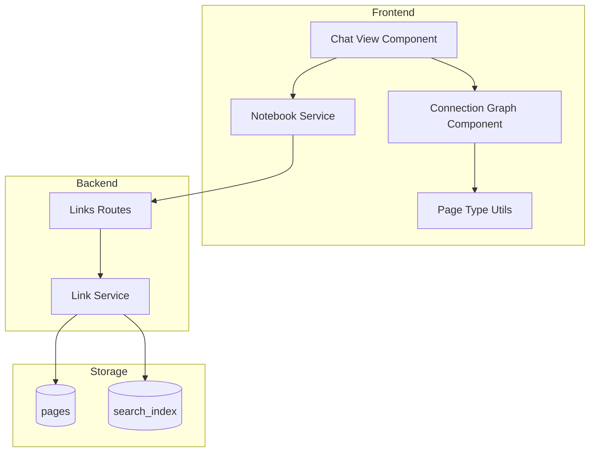

# Engineering: Connection Graph

The Connection Graph visualizes relationships between pages using D3.js force-directed layout. This document covers the implementation details.

## Architecture



## Data Flow

1. User navigates to notebook summary
2. `ChatViewComponent` requests connection graph via `NotebookService`
3. API fetches pages with their `linksMeta` and `tags`
4. `LinkService.getConnectionGraph()` builds graph data
5. Frontend renders using D3.js force simulation

## API Endpoints

### GET /api/links/connections/notebook/:notebookId

Returns connection graph for a specific notebook.

**Response:**

```typescript
{
  graph: {
    nodes: ConnectionNode[];
    edges: ConnectionEdge[];
    stats: {
      totalNodes: number;
      totalEdges: number;
      linkEdges: number;
      hashtagEdges: number;
    };
  };
}
```

### GET /api/links/connections

Returns full connection graph for the authenticated user across all notebooks.

## Data Structures

### ConnectionNode

```typescript
interface ConnectionNode {
    id: string; // Page ID
    label: string; // Page title
    type: string; // Page type (memo, whiteboard, etc.)
    linkCount: number; // Total connections
    tags?: string[]; // Hashtags on this page
    isCenter?: boolean; // For local graph views
}
```

### ConnectionEdge

```typescript
interface ConnectionEdge {
    source: string; // Source page ID
    target: string; // Target page ID
    type: 'inline' | 'block' | 'tag' | 'hashtag' | 'mention';
    label?: string; // e.g., "#project" for hashtag edges
}
```

## Backend Implementation

### Link Service (`apps/api/src/services/link.service.ts`)

The `getConnectionGraph()` function:

```typescript
export async function getConnectionGraph(
    userId: string,
    notebookId?: string,
): Promise<ConnectionGraph> {
    // 1. Query pages with linksMeta and tags
    const allPages = await pages
        .find(query)
        .project({
            id: 1,
            title: 1,
            type: 1,
            tags: 1,
            'linksMeta.forwardLinks': 1,
            'linksMeta.backlinks': 1,
        })
        .toArray();

    // 2. Build nodes from pages
    const nodes: ConnectionNode[] = allPages.map((page) => ({
        id: page.id,
        label: page.title || 'Untitled',
        type: page.type || 'memo',
        linkCount: forwardLinks.length + backlinks.length,
        tags: mergedTags,
    }));

    // 3. Add link edges (forward links only to avoid duplicates)
    for (const page of allPages) {
        for (const link of page.linksMeta?.forwardLinks || []) {
            edges.push({
                source: page.id,
                target: link.pageId,
                type: link.type || 'inline',
            });
        }
    }

    // 4. Add hashtag edges (connect pages sharing tags)
    for (const [tag, pageIds] of tagToPages) {
        if (pageIds.length >= 2) {
            for (let i = 0; i < pageIds.length; i++) {
                for (let j = i + 1; j < pageIds.length; j++) {
                    edges.push({
                        source: pageIds[i],
                        target: pageIds[j],
                        type: 'hashtag',
                        label: `#${tag}`,
                    });
                }
            }
        }
    }

    return { nodes, edges, stats };
}
```

### Edge Deduplication

- Link edges use forward links only (backlinks are the inverse)
- Hashtag edges skip pairs already connected by links
- Edge IDs track seen connections: `link:sourceId-targetId`

## Frontend Implementation

### Component Structure (Atomic Design)

```
components/
├── molecules/
│   └── connection-graph/
│       ├── connection-graph.component.ts
│       ├── connection-graph.component.html
│       └── connection-graph.component.scss
└── utils/
    └── page-types.ts  # Shared constants and utilities
```

### ConnectionGraphComponent

Located at `apps/web/src/app/components/molecules/connection-graph/`

**Inputs:**

```typescript
readonly nodes = input<GraphNode[]>([]);
readonly edges = input<GraphEdge[]>([]);
readonly stats = input<GraphStats | null>(null);
```

**Outputs:**

```typescript
readonly nodeClicked = output<string>(); // Emits page ID
```

### D3.js Integration

Force simulation configuration:

```typescript
this.simulation = d3
    .forceSimulation<GraphNode>(nodes)
    .force(
        'link',
        d3
            .forceLink(edges)
            .id((d) => d.id)
            .distance(80),
    )
    .force('charge', d3.forceManyBody().strength(-200))
    .force('center', d3.forceCenter(width / 2, height / 2))
    .force('collision', d3.forceCollide().radius(30));
```

**Constants (from `page-types.ts`):**

```typescript
export const GRAPH_CONSTANTS = {
    NODE_BASE_RADIUS: 8,
    NODE_MAX_CONNECTION_BONUS: 10,
    FORCE_LINK_DISTANCE: 80,
    FORCE_CHARGE_STRENGTH: -200,
    FORCE_COLLISION_RADIUS: 30,
    ZOOM_EXTENT: [0.1, 4],
};
```

### Shared Utilities (`apps/web/src/app/utils/page-types.ts`)

Extracted for DRY compliance:

```typescript
// Page type colors
export const PAGE_TYPE_COLORS: Record<string, string> = {
    memo: 'var(--color-primary)',
    whiteboard: '#10b981',
    message: '#3b82f6',
    // ...
};

// Utility functions
export function getPageTypeColor(type: string): string;
export function getPageTypeIcon(type: string): string;
export function getPageTypeLabel(type: string): string;
export function getNodeRadius(linkCount: number): number;
export function truncateLabel(label: string, maxLength?: number): string;
export function getEdgeColor(type: ConnectionEdgeType): string;
```

### Rendering Flow

```typescript
private renderGraph(nodes: GraphNode[], edges: GraphEdge[]): void {
    // 1. Clear previous SVG
    d3.select(container).select('svg').remove();

    // 2. Create SVG with zoom behavior
    this.svg = d3.select(container).append('svg');
    const g = this.svg.append('g');
    this.svg.call(d3.zoom().on('zoom', (e) => g.attr('transform', e.transform)));

    // 3. Create arrow markers
    this.createArrowMarkers(this.svg);

    // 4. Create force simulation
    this.simulation = d3.forceSimulation(nodes)...

    // 5. Render elements
    const link = this.createEdges(g, edges);
    const edgeLabels = this.createEdgeLabels(g, edges);
    const node = this.createNodes(g, nodes);

    // 6. Update positions on simulation tick
    this.simulation.on('tick', () => {
        this.updatePositions(link, edgeLabels, node);
    });
}
```

## Styling

### Node Styling

```scss
.node {
    transition: opacity 0.2s ease;

    &:hover circle {
        filter: brightness(1.1);
    }
}
```

### Edge Styling

```scss
.edge {
    opacity: 0.6;
    transition: opacity 0.2s ease;

    &:hover {
        opacity: 1;
    }
}
```

### Edge Types

| Type         | Stroke  | Dash Array | Arrow Marker      |
| ------------ | ------- | ---------- | ----------------- |
| inline/block | Primary | solid      | arrowhead-link    |
| hashtag      | Muted   | 4,2        | arrowhead-hashtag |

## Testing

### API Tests (`apps/api/src/routes/__tests__/links.test.ts`)

```typescript
describe('GET /api/links/connections/notebook/:notebookId', () => {
    it('should return connection graph with link edges', async () => {
        // Create pages with links
        // Verify nodes and edges
    });

    it('should return connection graph with hashtag edges', async () => {
        // Create pages with shared hashtags
        // Verify hashtag edges exist
    });

    it('should include node metadata', async () => {
        // Verify node has id, label, type, tags, linkCount
    });

    it('should require authentication', async () => {
        // Verify 401 without auth
    });
});
```

## Performance Considerations

### Backend

- Uses MongoDB projections to fetch only needed fields
- Builds hashtag map in memory for O(n) edge creation
- Skips trashed pages

### Frontend

- Deep copies nodes/edges before mutation by D3
- Stops previous simulation before creating new one
- Uses ResizeObserver for responsive updates
- Limits zoom extent to prevent over-zoom

## Key Files

| File                                                      | Purpose                         |
| --------------------------------------------------------- | ------------------------------- |
| `apps/api/src/services/link.service.ts`                   | Graph building logic            |
| `apps/api/src/routes/links.ts`                            | API endpoints                   |
| `packages/shared/src/schemas/link.ts`                     | Type definitions                |
| `apps/web/src/app/components/molecules/connection-graph/` | D3 visualization component      |
| `apps/web/src/app/utils/page-types.ts`                    | Shared constants/utilities      |
| `apps/web/src/app/pages/chat-view/`                       | Integration in notebook summary |
| `apps/api/src/routes/__tests__/links.test.ts`             | API tests                       |

## Future Enhancements

1. **Local graph view** - Center on a specific page with depth control
2. **Mention edges** - Connect pages mentioning same entities
3. **Cluster detection** - Highlight topic clusters automatically
4. **Graph export** - Export as image or JSON
5. **Time filtering** - Show connections from specific date ranges
