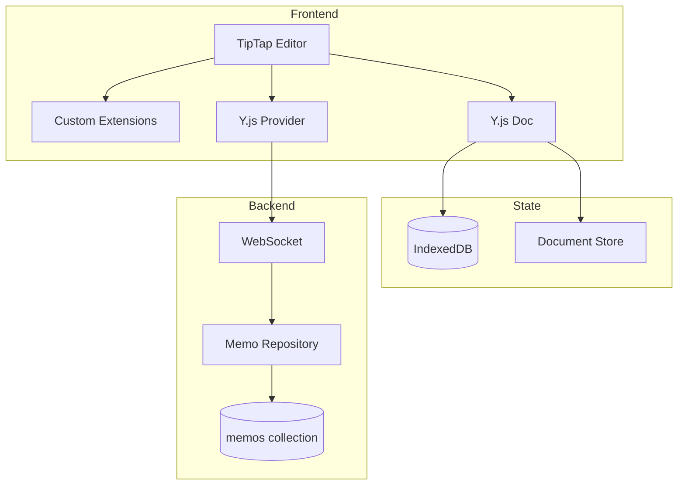

# Engineering: Memo Editor

The memo editor is built on TipTap (a headless ProseMirror wrapper) with Y.js for CRDT-based real-time collaboration. This document covers the implementation.

## Architecture



## TipTap Setup

### Editor Configuration

```typescript
// apps/web/src/app/components/organisms/notebook-editor/notebook-editor.component.ts
import { Editor } from '@tiptap/core';
import StarterKit from '@tiptap/starter-kit';
import Collaboration from '@tiptap/extension-collaboration';
import CollaborationCursor from '@tiptap/extension-collaboration-cursor';

@Component({
    selector: 'app-notebook-editor',
    templateUrl: './notebook-editor.component.html',
})
export class NotebookEditorComponent implements OnInit {
    private editor: Editor;
    private ydoc: Y.Doc;

    ngOnInit() {
        this.ydoc = new Y.Doc();

        this.editor = new Editor({
            element: this.editorElement.nativeElement,
            extensions: [
                StarterKit.configure({
                    history: false, // Handled by Yjs
                }),
                Collaboration.configure({
                    document: this.ydoc,
                }),
                CollaborationCursor.configure({
                    provider: this.provider,
                    user: {
                        name: this.currentUser.displayName,
                        color: this.getUserColor(),
                    },
                }),
                // Custom extensions
                EnhancedTaskItem,
                EnhancedTaskList,
                WikiLink,
                HashTag,
                Callout,
                ImageUpload,
            ],
        });
    }
}
```

## Custom Extensions

### Wiki Links

```typescript
// apps/web/src/app/components/organisms/notebook-editor/extensions/wiki-link.ts
import { Mark, mergeAttributes } from '@tiptap/core';
import { Plugin, PluginKey } from '@tiptap/pm/state';

export const WikiLink = Mark.create({
    name: 'wikiLink',

    addAttributes() {
        return {
            pageId: {
                default: null,
            },
            pageTitle: {
                default: null,
            },
        };
    },

    parseHTML() {
        return [{ tag: 'a[data-wiki-link]' }];
    },

    renderHTML({ HTMLAttributes }) {
        return [
            'a',
            mergeAttributes(HTMLAttributes, {
                'data-wiki-link': '',
                class: 'wiki-link',
            }),
            0,
        ];
    },

    addInputRules() {
        return [
            // [[Page Title]] syntax
            {
                find: /\[\[([^\]]+)\]\]/g,
                handler: ({ state, range, match }) => {
                    const pageTitle = match[1];
                    // Look up or create page, apply mark
                },
            },
        ];
    },

    addProseMirrorPlugins() {
        return [
            new Plugin({
                key: new PluginKey('wikiLinkClick'),
                props: {
                    handleClick: (view, pos, event) => {
                        const link = event.target as HTMLElement;
                        if (link.hasAttribute('data-wiki-link')) {
                            const pageId = link.getAttribute('data-page-id');
                            this.options.onNavigate(pageId);
                            return true;
                        }
                        return false;
                    },
                },
            }),
        ];
    },
});
```

### Hashtags

```typescript
// apps/web/src/app/components/organisms/notebook-editor/extensions/hashtag.ts
import { Node, mergeAttributes } from '@tiptap/core';

export const HashTag = Node.create({
    name: 'hashTag',
    group: 'inline',
    inline: true,
    atom: true,

    addAttributes() {
        return {
            tag: { default: '' },
        };
    },

    parseHTML() {
        return [{ tag: 'span[data-hashtag]' }];
    },

    renderHTML({ node }) {
        return [
            'span',
            {
                'data-hashtag': node.attrs.tag,
                class: 'hashtag',
            },
            `#${node.attrs.tag}`,
        ];
    },

    addInputRules() {
        return [
            {
                find: /#([\w-]+)/g,
                handler: ({ state, range, match }) => {
                    const tag = match[1];
                    const node = this.type.create({ tag });
                    // Insert hashtag node
                },
            },
        ];
    },
});
```

### Enhanced Task Item

```typescript
// apps/web/src/app/components/organisms/notebook-editor/extensions/enhanced-task-item.ts
import TaskItem from '@tiptap/extension-task-item';
import { Plugin, PluginKey } from '@tiptap/pm/state';

export const EnhancedTaskItem = TaskItem.extend({
    addAttributes() {
        return {
            ...this.parent?.(),
            id: {
                default: () => crypto.randomUUID(),
            },
            priority: {
                default: null, // 'low' | 'medium' | 'high'
            },
            dueDate: {
                default: null, // ISO date string
            },
            color: {
                default: null,
            },
        };
    },

    addProseMirrorPlugins() {
        return [
            // Plugin to ensure unique IDs when copying tasks
            new Plugin({
                key: new PluginKey('enhancedTaskItemUniqueIds'),
                appendTransaction(transactions, oldState, newState) {
                    const seenIds = new Set<string>();
                    const tr = newState.tr;
                    let modified = false;

                    newState.doc.descendants((node, pos) => {
                        if (node.type.name === 'taskItem') {
                            const id = node.attrs.id;
                            if (seenIds.has(id)) {
                                tr.setNodeMarkup(pos, undefined, {
                                    ...node.attrs,
                                    id: crypto.randomUUID(),
                                });
                                modified = true;
                            }
                            seenIds.add(id);
                        }
                    });

                    return modified ? tr : null;
                },
            }),
        ];
    },
});
```

## CRDT Integration

### Y.js WebSocket Provider

```typescript
// apps/web/src/app/services/yjs-ws-provider.ts
import * as Y from 'yjs';
import { WebsocketProvider } from 'y-websocket';

export class YjsDocumentProvider {
    private ydoc: Y.Doc;
    private provider: WebsocketProvider;

    constructor(
        private noteId: string,
        private wsUrl: string,
    ) {
        this.ydoc = new Y.Doc();

        this.provider = new WebsocketProvider(wsUrl, `memo:${noteId}`, this.ydoc, {
            connect: true,
            params: { token: this.authService.getToken() },
        });

        this.provider.on('status', ({ status }) => {
            console.log('Connection status:', status);
        });
    }

    getXmlFragment(): Y.XmlFragment {
        return this.ydoc.getXmlFragment('prosemirror');
    }

    getAwareness() {
        return this.provider.awareness;
    }

    destroy(): void {
        this.provider.destroy();
        this.ydoc.destroy();
    }
}
```

## Backend Implementation

### Memo Repository

```typescript
// apps/api/src/repositories/memo.repo.ts
import { ObjectId } from 'mongodb';
import * as Y from 'yjs';

interface MemoDocument {
    _id: ObjectId;
    noteId: string;
    state: Binary; // Y.js encoded state
    version: number;
    updatedAt: Date;
}

export async function getMemoState(noteId: string): Promise<Uint8Array | null> {
    const memo = await db.collection('memos').findOne({ noteId });
    return memo?.state?.buffer ?? null;
}

export async function saveMemoState(noteId: string, state: Uint8Array): Promise<void> {
    await db.collection('memos').updateOne(
        { noteId },
        {
            $set: {
                state: new Binary(state),
                updatedAt: new Date(),
            },
            $inc: { version: 1 },
        },
        { upsert: true },
    );
}

export async function initMemo(noteId: string): Promise<Uint8Array> {
    const ydoc = new Y.Doc();
    const state = Y.encodeStateAsUpdate(ydoc);

    await db.collection('memos').insertOne({
        noteId,
        state: new Binary(state),
        version: 1,
        createdAt: new Date(),
        updatedAt: new Date(),
    });

    return state;
}
```

### Memo Routes

```typescript
// apps/api/src/routes/memo.routes.ts
export const memoRoutes = new Elysia({ prefix: '/api/memos' })
    .use(jwtPlugin)
    .use(authMiddleware)
    .get('/:noteId/state', async ({ params, auth }) => {
        const { noteId } = params;

        // Verify access
        const page = await getPageById(noteId);
        if (!canAccessPage(auth.userId, page)) {
            throw new Error('Unauthorized');
        }

        let state = await getMemoState(noteId);

        if (!state) {
            state = await initMemo(noteId);
        }

        return {
            state: Buffer.from(state).toString('base64'),
        };
    })
    .post('/:noteId/sync', async ({ params, body, auth }) => {
        const { noteId } = params;
        const { changes } = body;

        // Decode changes
        const decodedChanges = changes.map((c: string) =>
            Uint8Array.from(atob(c), (ch) => ch.charCodeAt(0)),
        );

        await saveMemoChanges(noteId, decodedChanges);

        // Broadcast to other clients
        broadcastToRoom(`memo:${noteId}`, {
            type: 'changes',
            changes,
            sender: auth.userId,
        });

        return { success: true };
    });
```

## Toolbar Implementation

```typescript
// apps/web/src/app/components/organisms/editor-toolbar/editor-toolbar.component.ts
@Component({
    selector: 'app-editor-toolbar',
    templateUrl: './editor-toolbar.component.html',
})
export class EditorToolbarComponent {
    @Input() editor: Editor;

    readonly isInTaskItem = computed(() => {
        const { $from } = this.editor.state.selection;
        return $from.parent.type.name === 'taskItem' || $from.node(-1)?.type.name === 'taskItem';
    });

    readonly activeTaskAttrs = computed(() => {
        if (!this.isInTaskItem()) return null;

        const { $from } = this.editor.state.selection;
        const taskItem = $from.node(-1)?.type.name === 'taskItem' ? $from.node(-1) : $from.parent;

        return taskItem.attrs;
    });

    toggleBold(): void {
        this.editor.chain().focus().toggleBold().run();
    }

    toggleItalic(): void {
        this.editor.chain().focus().toggleItalic().run();
    }

    setHeading(level: 1 | 2 | 3): void {
        this.editor.chain().focus().toggleHeading({ level }).run();
    }

    setTaskPriority(priority: 'low' | 'medium' | 'high'): void {
        this.editor.chain().focus().updateAttributes('taskItem', { priority }).run();
    }

    setTaskDueDate(date: string): void {
        this.editor.chain().focus().updateAttributes('taskItem', { dueDate: date }).run();
    }
}
```

## Image Upload

```typescript
// apps/web/src/app/components/organisms/notebook-editor/extensions/image-upload.ts
import Image from '@tiptap/extension-image';

export const ImageUpload = Image.extend({
    addProseMirrorPlugins() {
        const uploadService = this.options.uploadService;

        return [
            new Plugin({
                key: new PluginKey('imageUpload'),
                props: {
                    handleDrop: (view, event) => {
                        const files = event.dataTransfer?.files;
                        if (!files?.length) return false;

                        for (const file of files) {
                            if (file.type.startsWith('image/')) {
                                uploadService.upload(file).then((url) => {
                                    const node = view.state.schema.nodes.image.create({
                                        src: url,
                                    });
                                    const tr = view.state.tr.insert(
                                        view.state.selection.from,
                                        node,
                                    );
                                    view.dispatch(tr);
                                });
                            }
                        }

                        return true;
                    },
                    handlePaste: (view, event) => {
                        const items = event.clipboardData?.items;
                        if (!items) return false;

                        for (const item of items) {
                            if (item.type.startsWith('image/')) {
                                const file = item.getAsFile();
                                if (file) {
                                    // Same upload logic
                                }
                            }
                        }

                        return false;
                    },
                },
            }),
        ];
    },
});
```

## Styling

```scss
// apps/web/src/app/components/organisms/notebook-editor/notebook-editor.component.scss
.ProseMirror {
    outline: none;
    min-height: 100%;

    h1 {
        @apply text-3xl font-bold mb-4;
    }
    h2 {
        @apply text-2xl font-semibold mb-3;
    }
    h3 {
        @apply text-xl font-medium mb-2;
    }

    p {
        @apply mb-2;
    }

    ul,
    ol {
        @apply ml-6 mb-2;
        li {
            @apply mb-1;
        }
    }

    ul[data-type='taskList'] {
        list-style: none;
        margin-left: 0;

        li {
            display: flex;
            align-items: flex-start;
            gap: 0.5rem;

            &[data-checked='true'] {
                .task-content {
                    @apply line-through text-gray-500;
                }
            }

            &[data-priority='high'] {
                border-left: 3px solid #dc2626;
                padding-left: 0.5rem;
            }

            &[data-priority='medium'] {
                border-left: 3px solid #f59e0b;
                padding-left: 0.5rem;
            }

            &[data-priority='low'] {
                border-left: 3px solid #3b82f6;
                padding-left: 0.5rem;
            }
        }
    }

    .wiki-link {
        @apply text-primary underline cursor-pointer;
        &:hover {
            @apply text-primary-hover;
        }
    }

    .hashtag {
        @apply text-blue-600 bg-blue-50 px-1 rounded;
    }

    code {
        @apply bg-gray-100 px-1 rounded font-mono text-sm;
    }

    pre {
        @apply bg-gray-900 text-gray-100 p-4 rounded-lg mb-4;
        code {
            @apply bg-transparent p-0;
        }
    }

    blockquote {
        @apply border-l-4 border-gray-300 pl-4 italic;
    }
}
```

## Related Documentation

- [Feature: Memo Editor](./feature-memo-editor.md) - User documentation
- [Engineering: Todos](./eng-todos.md) - Task list implementation
- [Engineering: Sync](./eng-sync.md) - CRDT synchronization
- [Architecture](./architecture.md) - System overview
