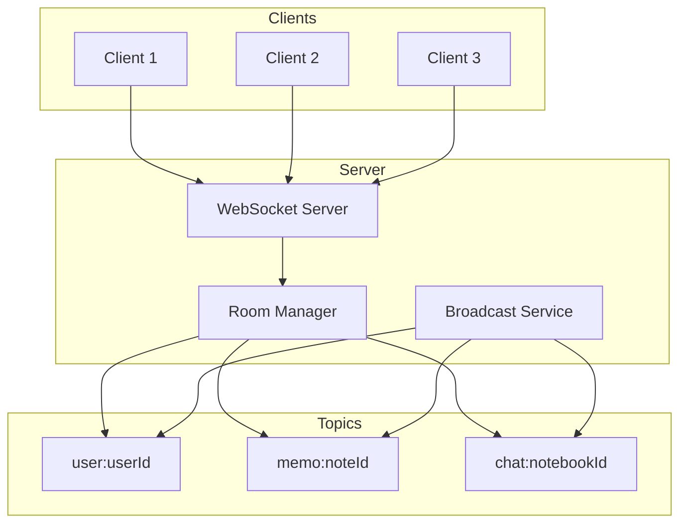

# Engineering: Real-time WebSocket

Just Maple uses WebSocket connections for real-time features including document sync, chat messages, and presence awareness.

## Architecture



## Server Implementation

### WebSocket Setup

```typescript
// apps/api/src/ws/index.ts
import { Elysia } from 'elysia';

interface WsData {
    userId: string;
    rooms: Set<string>;
}

export const wsRoutes = new Elysia().ws('/ws/realtime', {
    open(ws) {
        console.log('WebSocket connected:', ws.id);
    },

    close(ws) {
        console.log('WebSocket disconnected:', ws.id);
        // Clean up room subscriptions
        for (const room of ws.data.rooms) {
            ws.unsubscribe(room);
        }
    },

    message(ws, message) {
        handleMessage(ws, message as any);
    },
});
```

### Message Handler

```typescript
// apps/api/src/ws/handlers.ts
import type { ServerWebSocket } from 'bun';

interface IncomingMessage {
    type: string;
    [key: string]: any;
}

export async function handleMessage(
    ws: ServerWebSocket<WsData>,
    data: IncomingMessage,
): Promise<void> {
    switch (data.type) {
        // Authentication
        case 'auth':
            await handleAuth(ws, data.token);
            break;

        // Room management
        case 'join':
            handleJoin(ws, data.room);
            break;

        case 'leave':
            handleLeave(ws, data.room);
            break;

        // Document sync
        case 'sync':
            await handleSync(ws, data);
            break;

        // Chat
        case 'message':
            await handleChatMessage(ws, data);
            break;

        // Awareness (cursors, selections)
        case 'awareness':
            handleAwareness(ws, data);
            break;

        // Typing indicators
        case 'typing':
            handleTyping(ws, data);
            break;
    }
}

async function handleAuth(ws: ServerWebSocket<WsData>, token: string): Promise<void> {
    try {
        const payload = await verifyJwt(token);
        ws.data.userId = payload.sub;
        ws.data.rooms = new Set();

        // Subscribe to user-specific room
        ws.subscribe(`user:${payload.sub}`);
        ws.data.rooms.add(`user:${payload.sub}`);

        ws.send(JSON.stringify({ type: 'authSuccess' }));
    } catch {
        ws.send(JSON.stringify({ type: 'authError', error: 'Invalid token' }));
        ws.close();
    }
}

function handleJoin(ws: ServerWebSocket<WsData>, room: string): void {
    // Validate room access
    if (!canAccessRoom(ws.data.userId, room)) {
        ws.send(JSON.stringify({ type: 'joinError', room, error: 'Unauthorized' }));
        return;
    }

    ws.subscribe(room);
    ws.data.rooms.add(room);

    // Notify others in the room
    server.publish(
        room,
        JSON.stringify({
            type: 'userJoined',
            room,
            userId: ws.data.userId,
        }),
        true,
    );

    ws.send(JSON.stringify({ type: 'joined', room }));
}

function handleLeave(ws: ServerWebSocket<WsData>, room: string): void {
    ws.unsubscribe(room);
    ws.data.rooms.delete(room);

    server.publish(
        room,
        JSON.stringify({
            type: 'userLeft',
            room,
            userId: ws.data.userId,
        }),
        true,
    );
}
```

### Document Sync

```typescript
// apps/api/src/ws/sync.ts
async function handleSync(ws: ServerWebSocket<WsData>, data: any): Promise<void> {
    const { noteId, changes, heads } = data;
    const room = `memo:${noteId}`;

    // Apply changes to server document
    const result = await applyChangesWithConflictCheck(noteId, changes, heads);

    // Broadcast to other clients in the room
    server.publish(
        room,
        JSON.stringify({
            type: 'syncUpdate',
            noteId,
            changes,
            sender: ws.data.userId,
        }),
        true,
    ); // Exclude sender

    // Send acknowledgment
    ws.send(
        JSON.stringify({
            type: 'syncAck',
            noteId,
            success: result.success,
            merged: result.merged,
            heads: result.newHeads,
        }),
    );
}
```

### Awareness (Cursors)

```typescript
// apps/api/src/ws/awareness.ts
interface AwarenessState {
    cursor?: { x: number; y: number };
    selection?: { anchor: number; head: number };
    user: { name: string; color: string };
}

const awarenessStates = new Map<string, Map<string, AwarenessState>>();

function handleAwareness(ws: ServerWebSocket<WsData>, data: any): void {
    const { room, state } = data;

    // Store awareness state
    if (!awarenessStates.has(room)) {
        awarenessStates.set(room, new Map());
    }
    awarenessStates.get(room)!.set(ws.data.userId, state);

    // Broadcast to others
    server.publish(
        room,
        JSON.stringify({
            type: 'awareness',
            room,
            userId: ws.data.userId,
            state,
        }),
        true,
    );
}

// Clean up awareness on disconnect
function cleanupAwareness(ws: ServerWebSocket<WsData>): void {
    for (const room of ws.data.rooms) {
        const roomStates = awarenessStates.get(room);
        if (roomStates) {
            roomStates.delete(ws.data.userId);

            // Notify others
            server.publish(
                room,
                JSON.stringify({
                    type: 'awarenessRemoved',
                    room,
                    userId: ws.data.userId,
                }),
            );
        }
    }
}
```

## Client Implementation

### WebSocket Service

```typescript
// apps/web/src/app/services/realtime-ws.service.ts
@Injectable({ providedIn: 'root' })
export class RealtimeWsService {
    private ws: WebSocket | null = null;
    private reconnectAttempts = 0;
    private maxReconnectAttempts = 5;
    private messageHandlers = new Map<string, Subject<any>>();

    readonly connectionStatus = signal<'connecting' | 'connected' | 'disconnected'>('disconnected');

    constructor(private auth: AuthService) {
        this.connect();
    }

    private connect(): void {
        const wsUrl = `${environment.wsUrl}/ws/realtime`;
        this.ws = new WebSocket(wsUrl);
        this.connectionStatus.set('connecting');

        this.ws.onopen = () => {
            this.connectionStatus.set('connected');
            this.reconnectAttempts = 0;
            this.authenticate();
        };

        this.ws.onmessage = (event) => {
            const data = JSON.parse(event.data);
            this.handleMessage(data);
        };

        this.ws.onclose = () => {
            this.connectionStatus.set('disconnected');
            this.attemptReconnect();
        };

        this.ws.onerror = (error) => {
            console.error('WebSocket error:', error);
        };
    }

    private authenticate(): void {
        const token = this.auth.getToken();
        this.send({ type: 'auth', token });
    }

    private attemptReconnect(): void {
        if (this.reconnectAttempts >= this.maxReconnectAttempts) {
            console.error('Max reconnect attempts reached');
            return;
        }

        const delay = Math.pow(2, this.reconnectAttempts) * 1000;
        this.reconnectAttempts++;

        setTimeout(() => this.connect(), delay);
    }

    send(message: any): void {
        if (this.ws?.readyState === WebSocket.OPEN) {
            this.ws.send(JSON.stringify(message));
        }
    }

    private handleMessage(data: any): void {
        const handler = this.messageHandlers.get(data.type);
        if (handler) {
            handler.next(data);
        }
    }

    onMessage<T>(type: string): Observable<T> {
        if (!this.messageHandlers.has(type)) {
            this.messageHandlers.set(type, new Subject());
        }
        return this.messageHandlers.get(type)!.asObservable();
    }

    joinRoom(room: string): void {
        this.send({ type: 'join', room });
    }

    leaveRoom(room: string): void {
        this.send({ type: 'leave', room });
    }

    updateAwareness(room: string, state: AwarenessState): void {
        this.send({ type: 'awareness', room, state });
    }
}
```

### Cursor Tracking

```typescript
// apps/web/src/app/services/cursor-awareness.service.ts
@Injectable()
export class CursorAwarenessService {
    private ws = inject(RealtimeWsService);

    readonly remoteCursors = signal<Map<string, CursorState>>(new Map());

    private room: string | null = null;

    constructor() {
        this.ws.onMessage<AwarenessMessage>('awareness').subscribe((msg) => {
            if (msg.room === this.room) {
                this.remoteCursors.update((cursors) => {
                    const updated = new Map(cursors);
                    updated.set(msg.userId, msg.state);
                    return updated;
                });
            }
        });

        this.ws.onMessage<AwarenessRemovedMessage>('awarenessRemoved').subscribe((msg) => {
            if (msg.room === this.room) {
                this.remoteCursors.update((cursors) => {
                    const updated = new Map(cursors);
                    updated.delete(msg.userId);
                    return updated;
                });
            }
        });
    }

    setRoom(room: string): void {
        if (this.room) {
            this.ws.leaveRoom(this.room);
        }
        this.room = room;
        this.ws.joinRoom(room);
        this.remoteCursors.set(new Map());
    }

    updateCursor(position: { x: number; y: number }): void {
        if (this.room) {
            this.ws.updateAwareness(this.room, {
                cursor: position,
                user: this.currentUser,
            });
        }
    }

    updateSelection(anchor: number, head: number): void {
        if (this.room) {
            this.ws.updateAwareness(this.room, {
                selection: { anchor, head },
                user: this.currentUser,
            });
        }
    }
}
```

## Chat Real-time

### Chat Message Handler

```typescript
// apps/api/src/ws/chat.ts
async function handleChatMessage(ws: ServerWebSocket<WsData>, data: any): Promise<void> {
    const { notebookId, content, replyTo } = data;

    // Save message to database
    const message = await createMessage({
        notebookId,
        senderId: ws.data.userId,
        content,
        replyTo,
    });

    // Broadcast to notebook room
    server.publish(
        `chat:${notebookId}`,
        JSON.stringify({
            type: 'newMessage',
            message,
        }),
    );

    // Send push notifications to offline users
    await notifyOfflineUsers(notebookId, message);
}

function handleTyping(ws: ServerWebSocket<WsData>, data: any): void {
    const { notebookId, isTyping } = data;

    server.publish(
        `chat:${notebookId}`,
        JSON.stringify({
            type: 'typing',
            userId: ws.data.userId,
            isTyping,
        }),
        true,
    );
}
```

### Client Chat Integration

```typescript
// apps/web/src/app/services/chat.service.ts
@Injectable()
export class ChatService {
    private ws = inject(RealtimeWsService);

    readonly messages = signal<Message[]>([]);
    readonly typingUsers = signal<Set<string>>(new Set());

    private notebookId: string | null = null;

    constructor() {
        this.ws.onMessage<NewMessageEvent>('newMessage').subscribe((event) => {
            this.messages.update((msgs) => [...msgs, event.message]);
        });

        this.ws.onMessage<TypingEvent>('typing').subscribe((event) => {
            this.typingUsers.update((users) => {
                const updated = new Set(users);
                if (event.isTyping) {
                    updated.add(event.userId);
                } else {
                    updated.delete(event.userId);
                }
                return updated;
            });
        });
    }

    joinChat(notebookId: string): void {
        this.notebookId = notebookId;
        this.ws.joinRoom(`chat:${notebookId}`);
    }

    leaveChat(): void {
        if (this.notebookId) {
            this.ws.leaveRoom(`chat:${this.notebookId}`);
            this.notebookId = null;
        }
    }

    sendMessage(content: string, replyTo?: string): void {
        if (this.notebookId) {
            this.ws.send({
                type: 'message',
                notebookId: this.notebookId,
                content,
                replyTo,
            });
        }
    }

    setTyping(isTyping: boolean): void {
        if (this.notebookId) {
            this.ws.send({
                type: 'typing',
                notebookId: this.notebookId,
                isTyping,
            });
        }
    }
}
```

## Scaling Considerations

### Room-Based Pub/Sub

- Each document/chat has its own room
- Messages only sent to interested clients
- Efficient for many concurrent documents

### Connection Limits

- Monitor active connections
- Implement connection pooling if needed
- Consider Redis pub/sub for multi-server

### Message Batching

```typescript
// Batch awareness updates to reduce traffic
class AwarenessBatcher {
    private pending = new Map<string, any>();
    private flushTimeout: number | null = null;

    queue(room: string, state: any): void {
        this.pending.set(room, state);

        if (!this.flushTimeout) {
            this.flushTimeout = setTimeout(() => this.flush(), 50);
        }
    }

    private flush(): void {
        for (const [room, state] of this.pending) {
            this.ws.send({ type: 'awareness', room, state });
        }
        this.pending.clear();
        this.flushTimeout = null;
    }
}
```

## Related Documentation

- [Engineering: Sync](./eng-sync.md) - Offline sync implementation
- [Engineering: Chat](./eng-chat.md) - Chat implementation
- [Architecture](./architecture.md) - System overview
