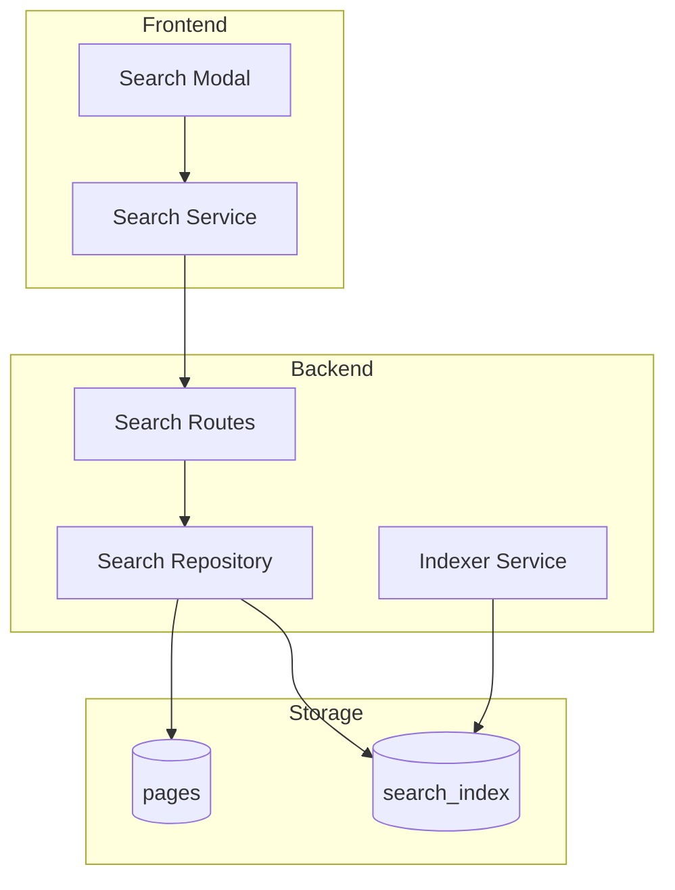

# Engineering: Search

Just Maple provides full-text search using regex-based matching (due to Cosmos DB limitations). This document covers the implementation.

## Architecture



## Why Regex-Based Search?

Azure Cosmos DB with MongoDB API does **not** support:

- `$text` operator
- Text indexes with weights
- `$or` with `.sort()`

We use `$regex` queries with application-side sorting instead.

## Search Index

### Schema

```typescript
// search_index collection
interface SearchIndexEntry {
    _id: ObjectId;
    pageId: string; // Reference to page
    notebookId: string;
    userId: string; // Owner
    plainText: string; // Searchable content
    title: string;
    tags: string[]; // Hashtags
    type: string; // memo, whiteboard, etc.
    updatedAt: Date;
}
```

### Indexing Service

```typescript
// apps/api/src/services/indexer.service.ts
export async function indexPage(page: Page): Promise<void> {
    const plainText = await extractPlainText(page);
    const tags = extractTags(plainText);

    await db.collection('search_index').updateOne(
        { pageId: page.id },
        {
            $set: {
                pageId: page.id,
                notebookId: page.notebookId,
                userId: page.userId,
                title: page.title || '',
                plainText,
                tags,
                type: page.type,
                updatedAt: new Date(),
            },
        },
        { upsert: true },
    );
}

async function extractPlainText(page: Page): Promise<string> {
    switch (page.type) {
        case 'memo':
            const memo = await getMemoState(page.id);
            if (memo) {
                // Y.js content extracted
                return yjsToPlainText(memo);
            }
            return '';

        case 'whiteboard':
            const whiteboard = await getWhiteboardState(page.id);
            return extractWhiteboardText(whiteboard);

        default:
            return page.title || '';
    }
}

function extractTags(text: string): string[] {
    const tagRegex = /#([\w-]+)/g;
    const tags: string[] = [];
    let match;

    while ((match = tagRegex.exec(text)) !== null) {
        tags.push(match[1].toLowerCase());
    }

    return [...new Set(tags)];
}
```

## Search Implementation

### Search Repository

```typescript
// apps/api/src/repositories/search.repo.ts
interface SearchOptions {
    query: string;
    notebookId?: string;
    type?: string;
    tags?: string[];
    limit?: number;
    offset?: number;
}

export async function search(userId: string, options: SearchOptions): Promise<SearchResult[]> {
    const { query, notebookId, type, tags, limit = 20, offset = 0 } = options;

    // Build query
    const filter: any = {
        userId,
    };

    // Regex search on title and content
    if (query) {
        const escapedQuery = escapeRegex(query);
        filter.$or = [
            { title: { $regex: escapedQuery, $options: 'i' } },
            { plainText: { $regex: escapedQuery, $options: 'i' } },
        ];
    }

    if (notebookId) {
        filter.notebookId = notebookId;
    }

    if (type) {
        filter.type = type;
    }

    if (tags && tags.length > 0) {
        filter.tags = { $all: tags.map((t) => t.toLowerCase()) };
    }

    // Fetch results (can't sort with $or in Cosmos, so fetch and sort in app)
    const results = await db
        .collection('search_index')
        .find(filter)
        .limit(limit + offset)
        .toArray();

    // Sort by relevance (title matches first, then recency)
    const scored = results.map((r) => ({
        ...r,
        score: calculateScore(r, query),
    }));

    scored.sort((a, b) => b.score - a.score);

    // Apply pagination
    return scored.slice(offset, offset + limit).map((r) => ({
        pageId: r.pageId,
        title: r.title,
        snippet: extractSnippet(r.plainText, query),
        type: r.type,
        notebookId: r.notebookId,
        tags: r.tags,
        score: r.score,
    }));
}

function calculateScore(entry: any, query: string): number {
    let score = 0;
    const lowerQuery = query.toLowerCase();

    // Title match is worth more
    if (entry.title.toLowerCase().includes(lowerQuery)) {
        score += 100;

        // Exact title match is even better
        if (entry.title.toLowerCase() === lowerQuery) {
            score += 50;
        }
    }

    // Content match
    if (entry.plainText.toLowerCase().includes(lowerQuery)) {
        score += 10;
    }

    // Recency bonus (decay over time)
    const ageInDays = (Date.now() - entry.updatedAt.getTime()) / (1000 * 60 * 60 * 24);
    score += Math.max(0, 20 - ageInDays);

    return score;
}

function extractSnippet(text: string, query: string, length = 150): string {
    const lowerText = text.toLowerCase();
    const lowerQuery = query.toLowerCase();
    const index = lowerText.indexOf(lowerQuery);

    if (index === -1) {
        return text.slice(0, length) + (text.length > length ? '...' : '');
    }

    const start = Math.max(0, index - 50);
    const end = Math.min(text.length, index + query.length + 100);

    let snippet = text.slice(start, end);
    if (start > 0) snippet = '...' + snippet;
    if (end < text.length) snippet = snippet + '...';

    return snippet;
}

function escapeRegex(str: string): string {
    return str.replace(/[.*+?^${}()|[\]\\]/g, '\\$&');
}
```

### Search Routes

```typescript
// apps/api/src/routes/search.routes.ts
export const searchRoutes = new Elysia({ prefix: '/api/search' })
    .use(jwtPlugin)
    .use(authMiddleware)
    .get('/', async ({ query, auth }) => {
        const { q, notebookId, type, tags, limit, offset } = query;

        if (!q) {
            return { results: [] };
        }

        const results = await search(auth.userId, {
            query: q,
            notebookId,
            type,
            tags: tags ? tags.split(',') : undefined,
            limit: limit ? parseInt(limit) : undefined,
            offset: offset ? parseInt(offset) : undefined,
        });

        return { results };
    })
    .post('/reindex', async ({ auth }) => {
        // Reindex all pages for user
        const pages = await getPagesByUserId(auth.userId);

        for (const page of pages) {
            await indexPage(page);
        }

        return { indexed: pages.length };
    })
    .put('/:pageId/tags', async ({ params, body, auth }) => {
        const { pageId } = params;
        const { tags } = body;

        await db
            .collection('search_index')
            .updateOne({ pageId, userId: auth.userId }, { $set: { tags } });

        return { success: true };
    });
```

## Frontend Implementation

### Search Service

```typescript
// apps/web/src/app/services/search.service.ts
@Injectable({ providedIn: 'root' })
export class SearchService {
    private http = inject(HttpClient);

    readonly query = signal('');
    readonly results = signal<SearchResult[]>([]);
    readonly loading = signal(false);
    readonly filters = signal<SearchFilters>({});

    private searchSubject = new Subject<string>();

    constructor() {
        // Debounce search requests
        this.searchSubject
            .pipe(
                debounceTime(200),
                distinctUntilChanged(),
                switchMap((query) => this.performSearch(query)),
            )
            .subscribe((results) => {
                this.results.set(results);
                this.loading.set(false);
            });
    }

    search(query: string): void {
        this.query.set(query);
        this.loading.set(true);
        this.searchSubject.next(query);
    }

    private performSearch(query: string): Observable<SearchResult[]> {
        if (!query.trim()) {
            return of([]);
        }

        const params: any = { q: query };
        const filters = this.filters();

        if (filters.notebookId) params.notebookId = filters.notebookId;
        if (filters.type) params.type = filters.type;
        if (filters.tags?.length) params.tags = filters.tags.join(',');

        return this.http
            .get<{ results: SearchResult[] }>('/api/search', { params })
            .pipe(map((r) => r.results));
    }

    setFilter(key: keyof SearchFilters, value: any): void {
        this.filters.update((f) => ({ ...f, [key]: value }));
        this.searchSubject.next(this.query());
    }

    clearFilters(): void {
        this.filters.set({});
        this.searchSubject.next(this.query());
    }
}
```

### Search Modal Component

```typescript
// apps/web/src/app/components/molecules/search-modal/search-modal.component.ts
@Component({
    selector: 'app-search-modal',
    templateUrl: './search-modal.component.html',
})
export class SearchModalComponent implements OnInit {
    private searchService = inject(SearchService);
    private router = inject(Router);

    @ViewChild('searchInput') searchInput!: ElementRef;

    readonly query = this.searchService.query;
    readonly results = this.searchService.results;
    readonly loading = this.searchService.loading;

    readonly selectedIndex = signal(0);

    ngOnInit(): void {
        // Focus input on open
        setTimeout(() => this.searchInput.nativeElement.focus());
    }

    onInput(event: Event): void {
        const value = (event.target as HTMLInputElement).value;
        this.searchService.search(value);
        this.selectedIndex.set(0);
    }

    onKeydown(event: KeyboardEvent): void {
        switch (event.key) {
            case 'ArrowDown':
                event.preventDefault();
                this.selectedIndex.update((i) => Math.min(i + 1, this.results().length - 1));
                break;
            case 'ArrowUp':
                event.preventDefault();
                this.selectedIndex.update((i) => Math.max(i - 1, 0));
                break;
            case 'Enter':
                event.preventDefault();
                this.openResult(this.results()[this.selectedIndex()]);
                break;
        }
    }

    openResult(result: SearchResult): void {
        this.router.navigate(['/', result.notebookId, result.pageId]);
        this.close();
    }

    close(): void {
        // Emit close event
    }
}
```

## Hashtag Sync

### On Content Change

```typescript
// Sync hashtags when document content changes
export async function syncHashtags(pageId: string, content: any): Promise<void> {
    const plainText = extractPlainTextFromContent(content);
    const tags = extractTags(plainText);

    await db.collection('search_index').updateOne(
        { pageId },
        {
            $set: {
                tags,
                plainText,
                updatedAt: new Date(),
            },
        },
    );

    // Also update page metadata
    await db.collection('pages').updateOne({ id: pageId }, { $set: { tags } });
}
```

## Performance Considerations

### Index Updates

- Index on document save, not on every keystroke
- Debounce indexing for rapid edits
- Async indexing doesn't block save

### Query Optimization

- Limit results per query
- Use compound indexes on common filters
- Cache recent searches

### Scaling

- Consider separate search service for large deployments
- Evaluate Elasticsearch/Meilisearch for advanced needs

## Related Documentation

- [Feature: Search](./feature-search.md) - User documentation
- [Data Model](./data-model.md) - Database schemas
- [Architecture](./architecture.md) - System overview
