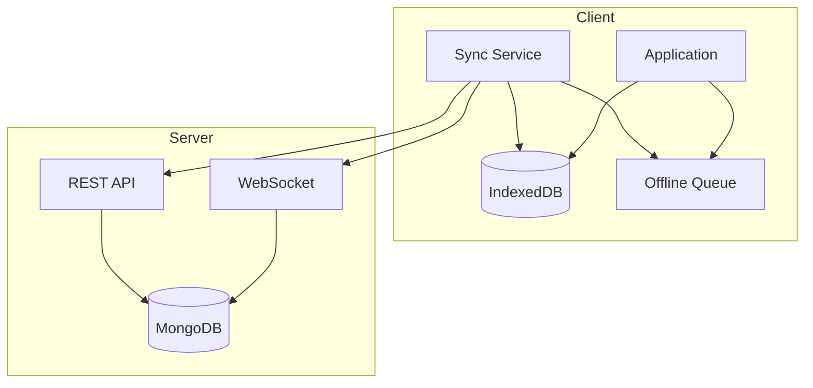

# Engineering: Sync & Offline

Just Maple uses Y.js CRDTs for offline-first synchronization. This document covers the implementation.

## Architecture



## CRDT Strategy

### Y.js for Documents

- Rich text content stored as Y.js documents
- Character-level CRDT for text operations
- Automatic merge resolution
- Provides awareness (cursors, selections)
- WebSocket provider for live updates
- Compatible with TipTap

## Offline Queue

### Queue Service

```typescript
// apps/web/src/app/services/offline-queue.service.ts
interface QueuedAction {
    id: string;
    type: 'create' | 'update' | 'delete';
    collection: string;
    documentId: string;
    payload: any;
    createdAt: number;
    retryCount: number;
}

@Injectable({ providedIn: 'root' })
export class OfflineQueueService {
    private queue = signal<QueuedAction[]>([]);
    private isProcessing = signal(false);
    private isOnline = signal(navigator.onLine);

    readonly pendingCount = computed(() => this.queue().length);
    readonly status = computed(() => {
        if (!this.isOnline()) return 'offline';
        if (this.isProcessing()) return 'syncing';
        if (this.queue().length > 0) return 'pending';
        return 'synced';
    });

    constructor(private idb: IndexedDBService) {
        // Listen for online/offline events
        window.addEventListener('online', () => this.onOnline());
        window.addEventListener('offline', () => this.isOnline.set(false));

        // Load queue from IndexedDB on startup
        this.loadQueue();
    }

    async enqueue(action: Omit<QueuedAction, 'id' | 'createdAt' | 'retryCount'>): Promise<void> {
        const queuedAction: QueuedAction = {
            ...action,
            id: crypto.randomUUID(),
            createdAt: Date.now(),
            retryCount: 0,
        };

        // Add to memory queue
        this.queue.update((q) => [...q, queuedAction]);

        // Persist to IndexedDB
        await this.idb.put('offlineQueue', queuedAction);

        // Try to process if online
        if (this.isOnline()) {
            this.processQueue();
        }
    }

    private async onOnline(): Promise<void> {
        this.isOnline.set(true);
        await this.processQueue();
    }

    private async processQueue(): Promise<void> {
        if (this.isProcessing() || this.queue().length === 0) {
            return;
        }

        this.isProcessing.set(true);

        try {
            const queue = [...this.queue()];

            for (const action of queue) {
                try {
                    await this.executeAction(action);

                    // Remove from queue on success
                    this.queue.update((q) => q.filter((a) => a.id !== action.id));
                    await this.idb.delete('offlineQueue', action.id);
                } catch (error) {
                    // Retry with exponential backoff
                    if (action.retryCount < 5) {
                        const delay = Math.pow(2, action.retryCount) * 1000;
                        action.retryCount++;
                        await this.idb.put('offlineQueue', action);
                        await this.delay(delay);
                    } else {
                        // Move to failed queue
                        await this.moveToFailed(action, error);
                    }
                }
            }
        } finally {
            this.isProcessing.set(false);
        }
    }

    private async executeAction(action: QueuedAction): Promise<void> {
        switch (action.type) {
            case 'create':
                await firstValueFrom(this.http.post(`/api/${action.collection}`, action.payload));
                break;
            case 'update':
                await firstValueFrom(
                    this.http.put(`/api/${action.collection}/${action.documentId}`, action.payload),
                );
                break;
            case 'delete':
                await firstValueFrom(
                    this.http.delete(`/api/${action.collection}/${action.documentId}`),
                );
                break;
        }
    }

    private delay(ms: number): Promise<void> {
        return new Promise((resolve) => setTimeout(resolve, ms));
    }

    private async loadQueue(): Promise<void> {
        const stored = await this.idb.getAll('offlineQueue');
        this.queue.set(stored);
    }
}
```

## Document Sync Service

### Y.js Sync

```typescript
// apps/web/src/app/services/memo-sync.service.ts
import * as Y from 'yjs';
import { IndexeddbPersistence } from 'y-indexeddb';
import { WebsocketProvider } from 'y-websocket';

@Injectable()
export class MemoSyncService {
    private documents = new Map<string, Y.Doc>();
    private providers = new Map<string, WebsocketProvider>();
    private persistence = new Map<string, IndexeddbPersistence>();

    constructor(private wsUrl: string) {}

    async initDocument(noteId: string): Promise<Y.Doc> {
        // Create Y.js document
        const ydoc = new Y.Doc();
        this.documents.set(noteId, ydoc);

        // Set up IndexedDB persistence
        const idbPersistence = new IndexeddbPersistence(`memo-${noteId}`, ydoc);
        this.persistence.set(noteId, idbPersistence);

        // Wait for local data to load
        await idbPersistence.whenSynced;

        // Connect to server via WebSocket
        const wsProvider = new WebsocketProvider(this.wsUrl, `memo:${noteId}`, ydoc);
        this.providers.set(noteId, wsProvider);

        return ydoc;
    }

    getXmlFragment(noteId: string): Y.XmlFragment | null {
        const doc = this.documents.get(noteId);
        return doc?.getXmlFragment('prosemirror') ?? null;
    }

    destroy(noteId: string): void {
        this.providers.get(noteId)?.destroy();
        this.persistence.get(noteId)?.destroy();
        this.documents.get(noteId)?.destroy();

        this.providers.delete(noteId);
        this.persistence.delete(noteId);
        this.documents.delete(noteId);
    }
}
```

## Conflict Resolution

Y.js handles conflicts automatically through its CRDT algorithm. Concurrent edits are merged without user intervention.

```typescript
// apps/web/src/app/services/conflict-resolution.service.ts
@Injectable()
export class ConflictResolutionService {
    // Y.js handles most conflicts automatically through its CRDT algorithm
    // Manual conflict resolution is rarely needed

    checkSyncStatus(provider: WebsocketProvider): SyncStatus {
        if (!provider.wsconnected) {
            return 'offline';
        }
        if (provider.synced) {
            return 'synced';
        }
        return 'syncing';
    }
}
```

## IndexedDB Storage

### Database Schema

```typescript
// apps/web/src/app/services/indexed-db.service.ts
const DB_SCHEMA = {
    name: 'justmaple',
    version: 1,
    stores: [
        {
            name: 'memos',
            keyPath: 'noteId',
        },
        {
            name: 'pages',
            keyPath: 'id',
            indexes: [
                { name: 'notebookId', keyPath: 'notebookId' },
                { name: 'updatedAt', keyPath: 'updatedAt' },
            ],
        },
        {
            name: 'offlineQueue',
            keyPath: 'id',
            indexes: [{ name: 'createdAt', keyPath: 'createdAt' }],
        },
        {
            name: 'syncState',
            keyPath: 'noteId',
        },
    ],
};

@Injectable({ providedIn: 'root' })
export class IndexedDBService {
    private db: IDBDatabase | null = null;

    async init(): Promise<void> {
        return new Promise((resolve, reject) => {
            const request = indexedDB.open(DB_SCHEMA.name, DB_SCHEMA.version);

            request.onupgradeneeded = (event) => {
                const db = (event.target as IDBOpenDBRequest).result;

                for (const store of DB_SCHEMA.stores) {
                    if (!db.objectStoreNames.contains(store.name)) {
                        const objectStore = db.createObjectStore(store.name, {
                            keyPath: store.keyPath,
                        });

                        for (const index of store.indexes || []) {
                            objectStore.createIndex(index.name, index.keyPath);
                        }
                    }
                }
            };

            request.onsuccess = (event) => {
                this.db = (event.target as IDBOpenDBRequest).result;
                resolve();
            };

            request.onerror = () => reject(request.error);
        });
    }

    async put<T>(store: string, value: T, key?: string): Promise<void> {
        return new Promise((resolve, reject) => {
            const tx = this.db!.transaction(store, 'readwrite');
            const objectStore = tx.objectStore(store);
            const request = key ? objectStore.put(value, key) : objectStore.put(value);

            request.onsuccess = () => resolve();
            request.onerror = () => reject(request.error);
        });
    }

    async get<T>(store: string, key: string): Promise<T | undefined> {
        return new Promise((resolve, reject) => {
            const tx = this.db!.transaction(store, 'readonly');
            const request = tx.objectStore(store).get(key);

            request.onsuccess = () => resolve(request.result);
            request.onerror = () => reject(request.error);
        });
    }

    async getAll<T>(store: string): Promise<T[]> {
        return new Promise((resolve, reject) => {
            const tx = this.db!.transaction(store, 'readonly');
            const request = tx.objectStore(store).getAll();

            request.onsuccess = () => resolve(request.result);
            request.onerror = () => reject(request.error);
        });
    }

    async delete(store: string, key: string): Promise<void> {
        return new Promise((resolve, reject) => {
            const tx = this.db!.transaction(store, 'readwrite');
            const request = tx.objectStore(store).delete(key);

            request.onsuccess = () => resolve();
            request.onerror = () => reject(request.error);
        });
    }
}
```

## Sync Status Component

```typescript
// apps/web/src/app/components/atoms/sync-status/sync-status.component.ts
@Component({
    selector: 'app-sync-status',
    template: `
        <div class="sync-status" [class]="status()">
            @switch (status()) {
                @case ('synced') {
                    <app-icon name="check-circle" />
                    <span>Synced</span>
                }
                @case ('syncing') {
                    <app-icon name="refresh" class="animate-spin" />
                    <span>Syncing...</span>
                }
                @case ('pending') {
                    <app-icon name="clock" />
                    <span>{{ pendingCount() }} pending</span>
                }
                @case ('offline') {
                    <app-icon name="wifi-off" />
                    <span>Offline</span>
                }
                @case ('conflict') {
                    <app-icon name="alert-triangle" />
                    <span>Conflict</span>
                }
                @case ('error') {
                    <app-icon name="x-circle" />
                    <span>Sync failed</span>
                }
            }
        </div>
    `,
})
export class SyncStatusComponent {
    private offlineQueue = inject(OfflineQueueService);

    readonly status = this.offlineQueue.status;
    readonly pendingCount = this.offlineQueue.pendingCount;
}
```

## Server-Side Sync Handler

```typescript
// apps/api/src/routes/ws.routes.ts
export function handleWebSocket(ws: ServerWebSocket<WsData>) {
    ws.subscribe(`user:${ws.data.userId}`);

    return {
        message: async (ws: ServerWebSocket<WsData>, message: string) => {
            const data = JSON.parse(message);

            switch (data.type) {
                case 'joinRoom':
                    ws.subscribe(`memo:${data.noteId}`);
                    break;

                case 'leaveRoom':
                    ws.unsubscribe(`memo:${data.noteId}`);
                    break;

                case 'sync':
                    const result = await applyChangesWithConflictCheck(
                        data.noteId,
                        decodeChanges(data.changes),
                        data.heads,
                    );

                    // Broadcast to other clients
                    server.publish(
                        `memo:${data.noteId}`,
                        JSON.stringify({
                            type: 'sync',
                            noteId: data.noteId,
                            changes: data.changes,
                            sender: ws.data.userId,
                        }),
                        true,
                    );

                    // Send ack to sender
                    ws.send(
                        JSON.stringify({
                            type: 'syncAck',
                            noteId: data.noteId,
                            success: result.success,
                            merged: result.merged,
                            newHeads: result.newHeads,
                        }),
                    );
                    break;

                case 'requestSync':
                    const memo = await getMemoState(data.noteId);
                    ws.send(
                        JSON.stringify({
                            type: 'fullSync',
                            noteId: data.noteId,
                            state: encodeState(memo),
                        }),
                    );
                    break;
            }
        },
    };
}
```

## Related Documentation

- [Feature: Offline Support](./feature-offline.md) - User documentation
- [Engineering: Realtime](./eng-realtime.md) - WebSocket implementation
- [Architecture](./architecture.md) - System overview
