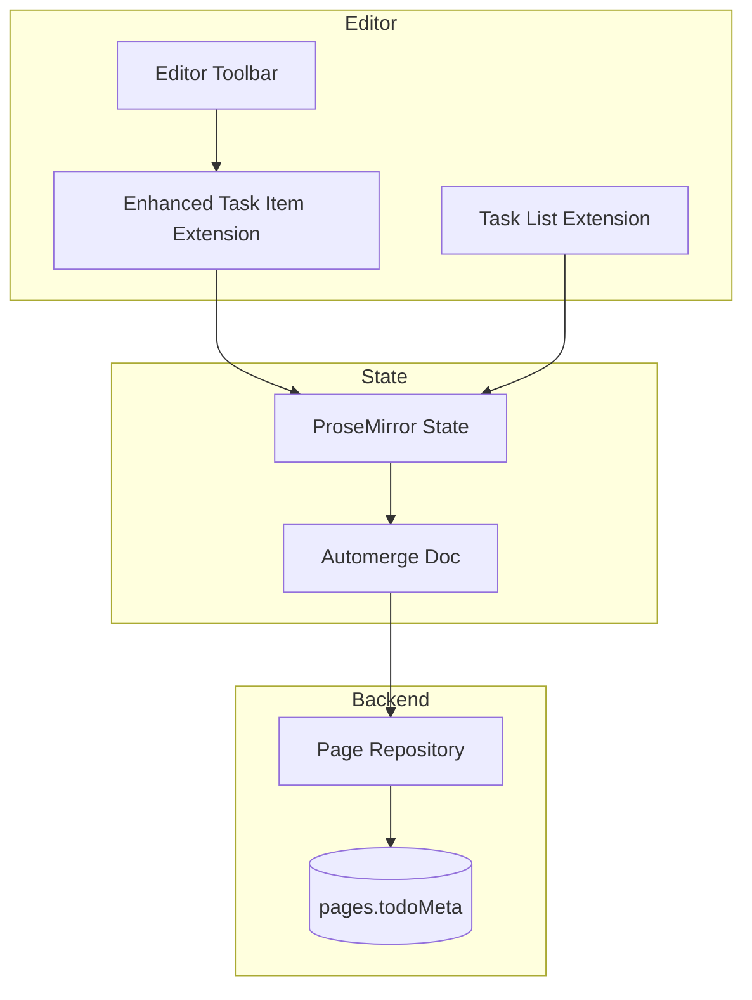

# Engineering: Enhanced Todos

The todo/task feature extends TipTap's built-in task list with priority, due dates, and color coding. This document covers the implementation.

## Architecture



## Task Item Extension

### Full Implementation

```typescript
// apps/web/src/app/components/organisms/notebook-editor/extensions/enhanced-task-item.ts
import TaskItem from '@tiptap/extension-task-item';
import { Plugin, PluginKey } from '@tiptap/pm/state';
import { Decoration, DecorationSet } from '@tiptap/pm/view';

declare module '@tiptap/core' {
    interface Commands<ReturnType> {
        enhancedTaskItem: {
            setTaskPriority: (priority: 'low' | 'medium' | 'high' | null) => ReturnType;
            setTaskDueDate: (dueDate: string | null) => ReturnType;
            setTaskColor: (color: string | null) => ReturnType;
        };
    }
}

export const EnhancedTaskItem = TaskItem.extend({
    name: 'taskItem',

    addOptions() {
        return {
            ...this.parent?.(),
            onTaskChange: () => {},
        };
    },

    addAttributes() {
        return {
            checked: {
                default: false,
                parseHTML: (el) => el.getAttribute('data-checked') === 'true',
                renderHTML: (attrs) => ({
                    'data-checked': attrs.checked,
                }),
            },
            id: {
                default: () => crypto.randomUUID(),
                parseHTML: (el) => el.getAttribute('data-id') || crypto.randomUUID(),
                renderHTML: (attrs) => ({
                    'data-id': attrs.id,
                }),
            },
            priority: {
                default: null,
                parseHTML: (el) => el.getAttribute('data-priority') || null,
                renderHTML: (attrs) =>
                    attrs.priority
                        ? {
                              'data-priority': attrs.priority,
                          }
                        : {},
            },
            dueDate: {
                default: null,
                parseHTML: (el) => el.getAttribute('data-due-date') || null,
                renderHTML: (attrs) =>
                    attrs.dueDate
                        ? {
                              'data-due-date': attrs.dueDate,
                          }
                        : {},
            },
            color: {
                default: null,
                parseHTML: (el) => el.getAttribute('data-color') || null,
                renderHTML: (attrs) =>
                    attrs.color
                        ? {
                              'data-color': attrs.color,
                              style: `--task-color: ${attrs.color}`,
                          }
                        : {},
            },
        };
    },

    addCommands() {
        return {
            ...this.parent?.(),
            setTaskPriority:
                (priority) =>
                ({ commands }) => {
                    return commands.updateAttributes('taskItem', { priority });
                },
            setTaskDueDate:
                (dueDate) =>
                ({ commands }) => {
                    return commands.updateAttributes('taskItem', { dueDate });
                },
            setTaskColor:
                (color) =>
                ({ commands }) => {
                    return commands.updateAttributes('taskItem', { color });
                },
        };
    },

    addProseMirrorPlugins() {
        const extensionThis = this;

        return [
            // Unique ID plugin
            new Plugin({
                key: new PluginKey('enhancedTaskItemUniqueIds'),
                appendTransaction(transactions, oldState, newState) {
                    // Only process if document changed
                    if (!transactions.some((tr) => tr.docChanged)) {
                        return null;
                    }

                    const seenIds = new Set<string>();
                    const tr = newState.tr;
                    let modified = false;

                    newState.doc.descendants((node, pos) => {
                        if (node.type.name === 'taskItem') {
                            const id = node.attrs.id;

                            if (!id || seenIds.has(id)) {
                                // Duplicate or missing ID
                                tr.setNodeMarkup(pos, undefined, {
                                    ...node.attrs,
                                    id: crypto.randomUUID(),
                                });
                                modified = true;
                            } else {
                                seenIds.add(id);
                            }
                        }
                    });

                    return modified ? tr : null;
                },
            }),

            // Due date decoration plugin
            new Plugin({
                key: new PluginKey('taskDueDateDecorations'),
                props: {
                    decorations(state) {
                        const decorations: Decoration[] = [];
                        const today = new Date().toISOString().split('T')[0];

                        state.doc.descendants((node, pos) => {
                            if (node.type.name === 'taskItem' && node.attrs.dueDate) {
                                const dueDate = node.attrs.dueDate;
                                const isOverdue = dueDate < today && !node.attrs.checked;

                                if (isOverdue) {
                                    decorations.push(
                                        Decoration.node(pos, pos + node.nodeSize, {
                                            class: 'task-overdue',
                                        }),
                                    );
                                }
                            }
                        });

                        return DecorationSet.create(state.doc, decorations);
                    },
                },
            }),
        ];
    },

    addKeyboardShortcuts() {
        return {
            ...this.parent?.(),
            'Mod-Enter': () => {
                // Toggle checked state
                const { $from } = this.editor.state.selection;
                const taskItem = $from.node(-1)?.type.name === 'taskItem' ? $from.node(-1) : null;

                if (taskItem) {
                    return this.editor.commands.updateAttributes('taskItem', {
                        checked: !taskItem.attrs.checked,
                    });
                }

                return false;
            },
        };
    },
});
```

## Todo Statistics

### Page-Level Aggregation

```typescript
// apps/api/src/repositories/page.repo.ts
interface TodoMeta {
    hasTodos: boolean;
    todoCount: number;
    completedCount: number;
    overdueCount: number;
}

export async function updatePageTodoMeta(
    pageId: string,
    content: any, // ProseMirror JSON or Automerge doc
): Promise<void> {
    const todos = extractTodos(content);
    const today = new Date().toISOString().split('T')[0];

    const todoMeta: TodoMeta = {
        hasTodos: todos.length > 0,
        todoCount: todos.length,
        completedCount: todos.filter((t) => t.checked).length,
        overdueCount: todos.filter((t) => !t.checked && t.dueDate && t.dueDate < today).length,
    };

    await db.collection('pages').updateOne({ id: pageId }, { $set: { todoMeta } });
}

function extractTodos(content: any): TaskAttrs[] {
    const todos: TaskAttrs[] = [];

    function traverse(node: any) {
        if (node.type === 'taskItem') {
            todos.push(node.attrs);
        }
        if (node.content) {
            node.content.forEach(traverse);
        }
    }

    traverse(content);
    return todos;
}
```

### Notebook-Level Stats

```typescript
// apps/api/src/repositories/page.repo.ts
export async function getTodoStatsForNotebook(notebookId: string): Promise<TodoStats> {
    const result = await db
        .collection('pages')
        .aggregate([
            { $match: { notebookId, 'todoMeta.hasTodos': true } },
            {
                $group: {
                    _id: null,
                    todoCount: { $sum: '$todoMeta.todoCount' },
                    completedCount: { $sum: '$todoMeta.completedCount' },
                    overdueCount: { $sum: '$todoMeta.overdueCount' },
                },
            },
        ])
        .toArray();

    return (
        result[0] || {
            todoCount: 0,
            completedCount: 0,
            overdueCount: 0,
        }
    );
}
```

## Toolbar Integration

### Detecting Active Task

```typescript
// apps/web/src/app/components/organisms/editor-toolbar/editor-toolbar.component.ts
@Component({
    selector: 'app-editor-toolbar',
    templateUrl: './editor-toolbar.component.html',
})
export class EditorToolbarComponent {
    @Input() editor!: Editor;

    private updateSignal = signal(0);

    constructor() {
        // Update on selection change
        effect(() => {
            this.editor.on('selectionUpdate', () => {
                this.updateSignal.update((n) => n + 1);
            });
        });
    }

    readonly activeTask = computed(() => {
        this.updateSignal(); // Trigger on updates

        const { $from } = this.editor.state.selection;

        // Check if inside task item
        for (let depth = $from.depth; depth >= 0; depth--) {
            const node = $from.node(depth);
            if (node.type.name === 'taskItem') {
                return {
                    node,
                    pos: $from.before(depth),
                    attrs: node.attrs as TaskAttrs,
                };
            }
        }

        return null;
    });

    readonly isInTask = computed(() => !!this.activeTask());

    setPriority(priority: 'low' | 'medium' | 'high' | null): void {
        this.editor.commands.setTaskPriority(priority);
    }

    setDueDate(date: string | null): void {
        this.editor.commands.setTaskDueDate(date);
    }

    setColor(color: string | null): void {
        this.editor.commands.setTaskColor(color);
    }
}
```

### Toolbar Template

```html
<!-- editor-toolbar.component.html -->
<div class="toolbar flex items-center gap-2 p-2 border-b">
    <!-- Standard formatting buttons -->
    <button (click)="toggleBold()" [class.active]="editor.isActive('bold')">
        <app-icon name="bold" />
    </button>
    <!-- ... other buttons ... -->

    <!-- Task-specific controls (shown when in task) -->
    @if (isInTask()) {
    <div class="divider"></div>

    <!-- Priority selector -->
    <div class="priority-selector">
        <button
            [class.active]="activeTask()?.attrs.priority === 'high'"
            (click)="setPriority('high')"
            class="priority-high"
        >
            High
        </button>
        <button
            [class.active]="activeTask()?.attrs.priority === 'medium'"
            (click)="setPriority('medium')"
            class="priority-medium"
        >
            Medium
        </button>
        <button
            [class.active]="activeTask()?.attrs.priority === 'low'"
            (click)="setPriority('low')"
            class="priority-low"
        >
            Low
        </button>
    </div>

    <!-- Due date picker -->
    <input
        type="date"
        [value]="activeTask()?.attrs.dueDate || ''"
        (change)="setDueDate($event.target.value)"
        class="due-date-picker"
    />

    <!-- Color picker -->
    <input
        type="color"
        [value]="activeTask()?.attrs.color || '#000000'"
        (change)="setColor($event.target.value)"
        class="color-picker"
    />
    }
</div>
```

## Todo View Page

### Component

```typescript
// apps/web/src/app/pages/todo-view/todo-view.component.ts
@Component({
    selector: 'app-todo-view',
    templateUrl: './todo-view.component.html',
})
export class TodoViewComponent implements OnInit {
    private http = inject(HttpClient);
    private route = inject(ActivatedRoute);

    readonly todos = signal<TodoItem[]>([]);
    readonly filter = signal<TodoFilter>({
        status: 'all',
        priority: null,
        dueDateRange: null,
    });

    readonly filteredTodos = computed(() => {
        const f = this.filter();
        return this.todos().filter((todo) => {
            if (f.status === 'pending' && todo.checked) return false;
            if (f.status === 'completed' && !todo.checked) return false;
            if (f.priority && todo.priority !== f.priority) return false;
            return true;
        });
    });

    ngOnInit(): void {
        const notebookId = this.route.snapshot.params['notebookId'];
        this.loadTodos(notebookId);
    }

    private async loadTodos(notebookId: string): Promise<void> {
        const response = await firstValueFrom(
            this.http.get<{ todos: TodoItem[] }>(`/api/notebooks/${notebookId}/todos`),
        );
        this.todos.set(response.todos);
    }

    async toggleTodo(todo: TodoItem): Promise<void> {
        // Update via memo document service
        await this.memoService.updateTaskChecked(todo.pageId, todo.id, !todo.checked);

        // Optimistically update local state
        this.todos.update((todos) =>
            todos.map((t) => (t.id === todo.id ? { ...t, checked: !t.checked } : t)),
        );
    }
}
```

### Todo Extraction Endpoint

```typescript
// apps/api/src/routes/notebook.routes.ts
.get('/:id/todos', async ({ params, auth }) => {
    const { id } = params;

    // Get all pages with todos
    const pages = await db.collection('pages')
        .find({
            notebookId: id,
            'todoMeta.hasTodos': true,
        })
        .toArray();

    const todos: TodoItem[] = [];

    for (const page of pages) {
        // Get memo content
        const memo = await getMemoState(page.id);
        if (memo) {
            const doc = Automerge.load(memo);
            const pageTodos = extractTodosWithContext(doc, page);
            todos.push(...pageTodos);
        }
    }

    // Sort by due date, then priority
    todos.sort((a, b) => {
        if (a.dueDate && b.dueDate) {
            return a.dueDate.localeCompare(b.dueDate);
        }
        if (a.dueDate) return -1;
        if (b.dueDate) return 1;

        const priorityOrder = { high: 0, medium: 1, low: 2, null: 3 };
        return (priorityOrder[a.priority] ?? 3) - (priorityOrder[b.priority] ?? 3);
    });

    return { todos };
})
```

## Styling

```scss
// notebook-editor.component.scss
ul[data-type='taskList'] {
    list-style: none;
    padding: 0;
    margin: 0;

    li[data-type='taskItem'] {
        display: flex;
        align-items: flex-start;
        gap: 0.5rem;
        padding: 0.25rem 0;
        border-radius: 0.25rem;
        transition: background-color 0.15s;

        &:hover {
            background-color: var(--color-bg-hover);
        }

        // Checkbox
        > label {
            display: flex;
            align-items: center;
            justify-content: center;
            width: 1.25rem;
            height: 1.25rem;
            margin-top: 0.125rem;

            input[type='checkbox'] {
                appearance: none;
                width: 1rem;
                height: 1rem;
                border: 2px solid var(--color-border);
                border-radius: 0.25rem;
                cursor: pointer;

                &:checked {
                    background-color: var(--color-primary);
                    border-color: var(--color-primary);

                    &::after {
                        content: '✓';
                        color: white;
                        font-size: 0.75rem;
                        display: flex;
                        align-items: center;
                        justify-content: center;
                    }
                }
            }
        }

        // Content
        > div {
            flex: 1;
        }

        // Checked state
        &[data-checked='true'] > div {
            text-decoration: line-through;
            color: var(--color-text-muted);
        }

        // Priority indicators
        &[data-priority='high'] {
            border-left: 3px solid #dc2626;
            padding-left: 0.5rem;
        }

        &[data-priority='medium'] {
            border-left: 3px solid #f59e0b;
            padding-left: 0.5rem;
        }

        &[data-priority='low'] {
            border-left: 3px solid #3b82f6;
            padding-left: 0.5rem;
        }

        // Custom color
        &[data-color] {
            border-left: 3px solid var(--task-color);
            padding-left: 0.5rem;
        }

        // Overdue
        &.task-overdue {
            background-color: rgba(220, 38, 38, 0.1);
        }
    }
}

// Due date badge
.due-date-badge {
    font-size: 0.75rem;
    padding: 0.125rem 0.375rem;
    border-radius: 0.25rem;
    background-color: var(--color-bg-secondary);

    &.overdue {
        background-color: #fef2f2;
        color: #dc2626;
    }

    &.due-today {
        background-color: #fef3c7;
        color: #d97706;
    }

    &.due-soon {
        background-color: #eff6ff;
        color: #3b82f6;
    }
}
```

## Related Documentation

- [Feature: Todos](./feature-todos.md) - User documentation
- [Engineering: Memo Editor](./eng-memo-editor.md) - Editor implementation
- [Data Model](./data-model.md) - Page schema with todoMeta
